# V7.0 — Analysis Round 8: Comprehensive Presentation Overhaul (Linguistic, Structural, Motion & Logical Architecture)

> **Input:** Voice notes in [14-transcription.md](14-transcription.md) (recorded 2026-10-31 by Omid).  
> **Target Material:** Current presentation (`/home/omid/projects/workshop/presentation/index.html`, 135 slides), previous source decks (`presentation1/`, `presentation2.html`, `presentation3/`), and the review logs in [13-presentation-issues.md](13-presentation-issues.md).  
> **Primary Directives:**  
> 1. **Complete Linguistic & Translation Overhaul:** Eradicate all unnatural phrasing, machine-translation artifacts (e.g., «دامپزشکی», «گریه کردن», «فرار دادن», «دستگیره»), and English syntactic calques (the repetitive «فلان، نه بهمان» pattern). Rewrite texts from scratch in natural, modern, fluent Persian with English technical terms in parentheses where appropriate.  
> 2. **Elimination of "Chips" & Rich Motion Scenarios:** Replace boring stacked text chips/badges with expressive narrative animations, specifically designing the requested atmospheric "Cloudy Journey / جاده‌ی ابری" roadmap for Slide 3 and converting static lists into interactive/animated mechanics.  
> 3. **Logical Flow & Conceptual Coherence:** Fix abrupt conceptual jumps (e.g., introducing the Harness in Act 1 as the mechanical runtime chassis before using it as a security gate in Act 3; properly defining general-purpose agent platforms before criticizing Hermes; establishing compelling narrative hooks).  
> 4. **English Clarifications:** Formulate specific questions for Omid in English on any concept where previous AI generated garbled text.

---

## 1. Linguistic & Translation Audit (پالایش بنیادین متن و اصطلاحات)

The current presentation suffers from two major linguistic defects:
1. **Comical Literal Translations & Unfamiliar Terminology (ترجمه‌های نامأنوس و مضحک):** Phrases translated word-by-word from English without technical domain awareness.
2. **English Syntactic Calques (گرته‌برداری نحوی):** The ubiquitous English rhetorical pattern «X, not Y» translated verbatim as «فلان چیز، نه بهمان چیز», which sounds foreign and repetitive in Persian.

### 1.1 The Specific Blunders Highlighted by the User

| Slide / Line | Current Garbled Text | Probable English Original | Analysis & Why It Failed | Recommended Modern Persian (متن پیشنهادی) |
|---|---|---|---|---|
| **Slide 68**<br>`L854` | `برای مدل، این سطر و سطرِ «قواعد»، هر دو فقط توکن‌اند — ترتیب و دامپزشکی تعیین می‌کند کدام غلبه کند، نه منشأشان.` | *"...order and vetting (or attention) determine which wins, not origin."* | **«دامپزشکی» (Veterinary)**: The AI translated the English verb/noun **"vetting"** (meaning verification, screening, or attention filtering) as "veterinary" (from vet)! An audience reading "ترتیب و دامپزشکی" in an AI deck is utterly baffled. | **«برای مدل زبانی، دستور مخرب و قواعد سیستمی هر دو فقط دنباله‌ای از توکن‌های متنی‌اند؛ این تقدم و تأخر کلمات و وزن توجه (Attention) است که بر خروجی اثر می‌گذارد، نه اعتبار یا منشأ دستور.»** |
| **Slide 18**<br>`L355` | `جستجوی کلیدواژه گریه می‌کند — واژه‌ها هیچ همپوشانی ندارند، ولی معنا یکی است.` | *"...keyword search weeps / cries out — words have no overlap..."* | **«گریه می‌کند»**: Literal translation of the English dramatic idiom "keyword search weeps/cries". In Persian, algorithms don't "cry"; it reads as absurd prose. | **«جستجوی سنتی کلیدواژه‌ای در اینجا کاملاً کم می‌آورد و به بن‌بست می‌خورد؛ کلمات هیچ اشتراکی ندارند، اما معنا و مفهوم کاملاً یکسان است.»** |
| **Slide 63–64**<br>`L795, L809` | `درمان: فرار دادن — < و > به &lt; و &gt; تبدیل می‌شدند...`<br>`هیچ کاراکتری نیست که فرارش دهیم...`<br>`فرارِ ممکن نیست` | *"remedy: escaping `<` and `>`..."*<br>*"no character to escape..."*<br>*"escape is not possible"* | **«فرار دادن»**: Translating character escaping (HTML escape) as "فرار دادن" makes it sound like helping prisoners escape jail. | **«راهکار در دنیای وب: خنثی‌سازی نویسه‌های کنترلی (Escape کردن) — تبدیل < و > به کدهای معادل تا اسکلت کد تشکیل نشود.»**<br>و در اسلاید بعد: **«اما در مدل‌های زبانی، دستور و داده هر دو در یک جریان متنی یکپارچه سرازیر می‌شوند؛ نویسهٔ خاصی وجود ندارد که با خنثی‌سازی (Escape) بتوان دستور را از داده جدا کرد.»** |
| **Slide 87–88**<br>`L1045, L1060` | `راه‌حل: پاکت و دستگیره — رفت` | *"Solution: Envelope and handle..."* | **«دستگیره»**: Translating an opaque programming **Handle** (token/reference) as "دستگیره" evokes a door handle or frying pan handle. | **«جداسازی اطلاعات حساس با توکن‌های ارجاع (Opaque Handle)»** یا **«الگوی گاوصندوق و شناسهٔ ارجاع (Handle)»** |
| **Slide 90**<br>`L1082` | `اوراکلِ وجود را هم ببند` | *"Close the existence oracle"* | **«اوراکل وجود»**: Unexplained cryptographic jargon. To a general audience, "اوراکل" suggests Delphi or Oracle database. | **«بستن کانال نشت اطلاعات هویتی (Existence Leakage): حتی وجود یا عدم وجود یک حساب یا رکورد نباید برای مهاجم قابل کشف باشد.»** |
| **Slide 13**<br>`L295` | `مدل‌های استدلالگر: دنده‌ی سنگین` | *"Reasoning models: heavy gear"* | **«دنده‌ی سنگین»**: A clunky automotive metaphor that obscures the actual mechanism (thinking tokens / Chain-of-Thought). | **«مدل‌های استدلال‌گر: تفکر عمیق گام‌به‌گام (Reasoning Models)»** |
| **Slide 70, 101**<br>`L875, L1183` | `همان مدلِ بیزانس که در پرده‌ی سوم دیدیم` | *"Byzantine adversary / model"* | **«بیزانس»**: Dropped without introduction. Audience thinks of the Roman Empire. | **«مدل فرضیهٔ بی‌اعتمادی کامل (مدل تهدید بیزانسی / Byzantine Adversary)؛ فرضیه‌ای که در آن فرض می‌کنیم تماس‌گیرنده ممکن است عامدانه مهاجم باشد.»** |

---

### 1.2 Eradication of the «فلان، نه بهمان» (X, not Y) English Calque

In natural Persian, contrast is expressed through varied syntactic devices:
- «به‌جای X، از Y استفاده می‌کنیم»
- «X است، بدون آنکه Y باشد»
- «تنها X را انجام می‌دهد و به Y دسترسی ندارد»
- «X است، فارغ از Y»

Here is the systematic rewrite of all 22+ occurrences across the deck:

| Slide # | Current Text (English Calque) | Natural Modern Persian Rewrite |
|---|---|---|
| **6** | `فقط چهره را تشخیص می‌داد — نه متن، نه صدا` | **«تنها چهره را تشخیص می‌داد و اصلاً متن یا صدا را نمی‌شناخت.»** |
| **6** | `فقط زبان را عوض می‌کرد — نه خلاصه، نه کد` | **«صرفاً زبان را ترجمه می‌کرد، بدون اینکه توان خلاصه‌سازی متن یا تولید کد داشته باشد.»** |
| **6** | `فقط شطرنج بازی می‌کرد — حتی یک ایمیل هم نمی‌نوشت` | **«تمام تمرکزش روی بازی شطرنج بود و حتی یک ایمیل ساده هم نمی‌توانست بنویسد.»** |
| **14** | `فقط با آنچه یاد گرفته حرف می‌زند — نه خبری از دیروز دارد، نه جستجو می‌کند` | **«پاسخ‌هایش محدود به داده‌های زمان آموزش است؛ از رخدادهای تازه بی‌خبر است و خودش هم توان جستجو در وب را ندارد.»** |
| **19** | `یک مدلِ دیگر — نه زبانی و نه تولیدکننده` | **«مدلی تخصصی که برخلاف مدل‌های زبانی، متن تولید نمی‌کند؛ بلکه بردار عددی می‌سازد.»** |
| **20** | `زاویه را می‌سنجیم، نه طول را` | **«به‌جای طول بردار، زاویه و میزان هم‌جهت بودنِ آن‌ها را می‌سنجیم.»** |
| **21** | `جواب از متنِ ما درمی‌آید، نه از حدس` | **«پاسخ مستقیماً بر اساس مستندات واقعی شما تولید می‌شود، بدون حدس و گمانِ بی‌پایه.»** |
| **31** | `اشتباه در گام سوم: حالا کلِ ادامه روی فرضِ غلط سوار می‌شود — نه چون مدل بد است، چون زنجیره طولانی است` | **«خطا در گام سوم باعث انحراف کل مراحل بعدی می‌شود؛ این انحراف نتیجهٔ ذاتِ زنجیره‌ای کارهاست، نه لزوماً ضعف مدل.»** |
| **34** | `هر سه «متنِ توصیه‌کننده»‌اند — نه «قانونِ اجباری»` | **«هر سه این‌ها دستورالعمل‌هایی متنی و مشورتی هستند، نه قوانینِ قطعی و اجباری نرم‌افزاری.»** |
| **41** | `آیا واقعاً کار را تمام کرد؟ — نه اینکه فقط جوابِ قشنگ داد` | **«آیا کار واقعاً در عمل به سرانجام رسید، یا مدل صرفاً پاسخی خوش‌رنگ‌ولعاب تحویل داد؟»** |
| **48** | `بارِ ذهنی: باید زبانِ پیکربندیِ «او» را یاد بگیری، نه مسئله‌ی «خودت» را` | **«بخش عمده‌ای از انرژی ذهنی صرف یادگیری پیچیدگی‌های پلتفرم می‌شود، به‌جای اینکه روی اصل مسئلهٔ خودتان تمرکز کنید.»** |
| **54** | `پایتون را «بهتر» بلد است، نه چون سریع‌تر یا امن‌تر، چون نمونه‌اش را بیشتر دیده` | **«هوش مصنوعی پایتون را بهتر می‌نویسد، صرفاً به این دلیل که در داده‌های آموزشی نمونه‌های بسیار بیشتری از آن دیده است.»** |
| **56** | `آزاد در ساختن، سخت‌گیر در اجرا — و میزانِ سختگیری را سازنده‌ی ایجنت تعیین می‌کند — نه پیکربندیِ یک سکو` | **«آزادی کامل در مرحلهٔ ساخت و سخت‌گیری آهنین در زمان اجرا؛ مرز این سخت‌گیری را خود شما بر اساس منطق کسب‌وکارتان تعیین می‌کنید، نه تنظیمات ازپیش‌تعیین‌شدهٔ یک پلتفرم.»** |
| **58** | `نه بیشتر تا آسیب بزند، نه کمتر تا کار ناتمام بماند` | **«دقیقاً در همان چهارچوب مجاز: نه فراتر می‌رود که آسیبی بزند و نه کوتاهی می‌کند که کار ناتمام بماند.»** |
| **61** | `اگر نه: API — اما از کشورِ دوست، نه متخاصم` | **«در غیر این صورت: استفاده از API ارائه‌دهندگان معتبر در کشورهای دوست و هم‌پیمان، به دور از سرویس‌های متخاصم.»** |
| **65** | `کدِ قطعیِ اطرافِ مدل — نه درونِ مدل` | **«کدِ قطعی و کنترلی که گرداگرد مدل را احاطه کرده، بیرون از فضای پردازش متن.»** |
| **69** | `مهاجم می‌تواند متن را فریب دهد، نه کد را — کد، متن نمی‌خواند` | **«مهاجم شاید بتواند متن مدل را فریب دهد، اما منطقِ سفت‌وسخت کد هرگز فریب متن را نمی‌خورد.»** |
| **81** | `هویت از توکنِ نشست یا کانال می‌آید — نه از پرامپت یا آرگومانِ مدل` | **«هویت کاربر مستقیماً از سشن احراز هویت شده یا کانال ارتباطی استخراج می‌شود و هیچ وابستگی به ادعای متنی مدل یا کاربر ندارد.»** |
| **84** | `کارتِ تأیید را سیستم می‌سازد، نه مدل` | **«طراحی و ارسال کارت تأیید مستقیماً توسط سیستم انجام می‌شود و مدل هیچ کنترلی روی ظاهر و محتوای آن ندارد.»** |
| **89** | `پاکتِ برگشتی — راز به کاربر می‌رسد، نه به مدل` | **«اطلاعات محرمانه مستقیماً به دست کاربر نهایی می‌رسد، بدون اینکه در تاریخچه یا حافظهٔ مدل ثبت شود.»** |
| **102** | `استانداردِ اتصالِ ابزار به ایجنت — نه برای ایجنت به ایجنت` | **«استانداردی برای اتصال ابزارها به یک ایجنت منفرد؛ نباید آن را با پروتکل ارتباط میان دو ایجنت اشتباه گرفت.»** |
| **105** | `الگوی درستِ دوم: حقِ درخواستِ امضا بده، نه خودِ کلید — سیاستِ امضا بیرون از دستِ ایجنت می‌ماند` | **«به‌جای سپردن کلید اصلی به ایجنت، تنها حقِ درخواست امضا به او داده می‌شود تا سیاست‌های تأیید همواره در کدی مستقل کنترل شوند.»** |
| **106** | `«ایجنتِ من به نیابتِ من با ایجنتِ تو قرارداد ببندد» — هنوز مرزِ پژوهش است، نه محصولِ آماده` | **«اینکه ایجنت من مستقلاً با ایجنت دیگری مذاکره و قرارداد منعقد کند، هنوز در مرزهای پژوهش دانشگاهی است و به یک محصول پایدار صنعتی تبدیل نشده است.»** |
| **117** | `باارزش‌ترین چیز: روابطِ میانِ افراد — نه «مُهر»` | **«ماندگارترین دارایی در عصر هوش مصنوعی، پیوندهای عاطفی و شبکهٔ روابط انسانی است؛ مُهر و امضای اداری صرفاً سدی شکننده است.»** |
| **118** | `مُهر سدّی حقوقی است، نه ارزشِ نهایی — و به هر حال قیمتش می‌ریزد` | **«مُهر صرفاً مانعی موقت و قانونی است و به مرور زمان ارزش انحصاری آن فرو خواهد ریخت.»** |
| **120** | `این سناریوست، نه قطعیت` | **«این چشم‌انداز صرفاً یک سناریوی محتمل برای آینده است، نه تقدیری قطعی و غیرقابل تغییر.»** |
| **134** | `امنیت را در هارنس بنویس، نه در متن` | **«مرزهای امنیت را در کدِ قطعیِ هارنس تضمین کن و هرگز به پرامپت‌های متنی اعتماد نکن.»** |

---

## 2. Motion Architecture & Eliminating "Chips" (سناریوهای حرکتی و جایگزینی چیپس‌ها)

Omid was explicit: stacking vertical text chips/badges repeatedly feels dry, uninspired, and repetitive. We need cinematic scenarios and dynamic state-driven visual mechanisms.

### 2.1 The Signature Atmospheric Motion: "The Cloudy Journey" (اسلاید ۳ — نقشه‌ی راهِ ابری)

Omid’s creative prompt:
> *«مثلا اسلاید فهرست که پرده ها را میگه تا یه حدی تبدیل به موشن شده ولی خیلی جای کار بهتری داشت میتونست یه سناریو بهتر بیاد مثلا میتونست یه دونه سناریو بیاد که یه جای ابری مثلا نشون داده بشه که حالا من هر یه دونه دکمه بعدی رو که میزنم یه ذره از مسیر روشن بشه...»*

#### Narrative Storyboard (سناریوی روایی)
- **Initial State (ورود به اسلاید):** A dark, dramatic mountain landscape viewed from above. Dense, swirling volumetric mist and fog (`ابرهای متحرک`) shroud the path ahead. The audience sees only the beginning of a trail and a faint glowing waypoint where the traveler stands.
- **Beat 1 (کلیک اول / پرده‌ی یکم — بنیان):** A warm beam of amber/gold light pierces the fog, sweeping across the first curve of the road. The mist parts around Station 1. The traveler dot glides forward. The label glows: **«پرده‌ی یکم: بنیان — از حدس کلمه تا مغز و دست‌های ایجنت»**.
- **Beat 2 (کلیک دوم / پرده‌ی دوم — تحول نرم‌افزار):** The light advances further into the valley. Fog lifts from the second mountain pass. Station 2 reveals itself in cyan: **«پرده‌ی دوم: تحول نرم‌افزار — گذر از پلتفرم‌های عام‌منظوره به سامانه‌های اختصاصی»**.
- **Beat 3 (کلیک سوم / پرده‌ی سوم — مهار و امنیت):** The traveler enters a narrow, fortified mountain gate. A fierce crimson/violet beam illuminates the fortress walls. The fog dissolves around Station 3: **«پرده‌ی سوم: مهار و امنیت — هارنس و سه ستونِ دفاعی»**.
- **Beat 4 (کلیک چهارم / پرده‌ی چهارم — جهانِ ایجنت‌ها):** The road ascends to a wide, star-lit plateau overlooking a vast network of lights. The final cloud canopy burns away, revealing Station 4 in emerald: **«پرده‌ی چهارم: جهانِ ایجنت‌ها — دستیار شخصی، متخصصان و افق پیش‌رو»**.
- **Beat 5 (کلیک پنجم / پایانی — آینده و مهارت):** The entire panorama is now visible, bathed in light, showing the complete journey from start to horizon.

#### Technical Implementation Architecture
```html
<!-- Slide 3 Structure -->
<section class="s" id="roadmap-slide" data-act="آغاز">
  <div class="cloudy-scene">
    <!-- Atmospheric SVG canvas with dynamic fog masks -->
    <svg class="journey-map" viewBox="0 0 1200 650">
      <defs>
        <!-- Dynamic radial gradient mask revealing the road -->
        <filter id="cloud-fog">
          <feTurbulence type="fractalNoise" baseFrequency="0.015" numOctaves="4" result="noise"/>
          <feDisplacementMap in="SourceGraphic" in2="noise" scale="35" xChannelSelector="R" yChannelSelector="G"/>
        </filter>
        <mask id="fog-cutout">
          <rect width="100%" height="100%" fill="black" />
          <!-- Revealing circles along the path driven by step index -->
          <circle id="reveal-light" cx="150" cy="500" r="160" fill="white" filter="blur(25px)" />
        </mask>
      </defs>
      
      <!-- Winding Mountain Road -->
      <path class="road-backdrop" d="M 120 520 C 300 520, 250 380, 450 360 C 650 340, 600 210, 800 190 C 1000 170, 950 80, 1100 80" />
      <path class="road-active" d="..." mask="url(#fog-cutout)" />
      
      <!-- Fog layers overlay -->
      <g class="fog-layers">
        <rect class="fog-layer f1" width="100%" height="100%" />
        <rect class="fog-layer f2" width="100%" height="100%" />
      </g>
      
      <!-- Waypoint Stations -->
      <g class="station st-1" data-step="1">...</g>
      <g class="station st-2" data-step="2">...</g>
      <g class="station st-3" data-step="3">...</g>
      <g class="station st-4" data-step="4">...</g>
      
      <!-- Glowing Traveler on offset-path -->
      <circle class="traveler-dot" r="8" />
    </svg>
  </div>
</section>
```

---

### 2.2 Replacing Other Static "Chips" with Visual Motions

| Current Slide(s) | Current Static Chip Problem | Proposed Animated Motion / Consolidation |
|---|---|---|
| **Slide 5**<br>(AI Timeline: 6 chips) | 6 stacked chips showing 1958, 1986, 2012, 2017, 2022, 2024. Dry and static. | **Exponential S-Curve Motion (نمودار شتاب تاریخی):** A glowing temporal timeline curve. As the presenter steps through, the line surges upward slowly from 1958 to 2017, then violently vertical into 2024+, showing the explosion of agentic reasoning. |
| **Slides 16 & 21**<br>(RAG: 4 chips + 4 chips) | Two separate slides listing the 4 steps of RAG with bullet chips. Redundant and static. | **Merge into an Animated Pipeline (خط لوله‌ی متحرک RAG):** An interactive animated diagram. A document is chunked, floating text turns into coordinate points on an embedding grid, a user query vector fires in, cosine similarity lines highlight the nearest chunk, and the prompt dynamically expands. |
| **Slide 61**<br>(Threat 1 Defenses: 3 chips) | Three bullet chips: proprietary > open weight > API. | **The Sovereign Fortress Wall (دیواره‌ی پدافند حاکمیتی):** Visual concentric rings or defense tiers. Tier 1 (Outer perimeter: API with harness shields), Tier 2 (Moat: Open-weight model hosted on local infrastructure), Tier 3 (Citadel: Proprietary fine-tuned model). Shows where data leaks stop. |
| **Slide 73 & 82**<br>(Permission Tiers: chips) | Chips classifying actions into Read vs Approval vs Blocked. | **Airport Customs / Security Gate (گیت بازرسی سه‌مسیره):** A visual turnstile mechanism. Inbound tool calls roll down conveyor belts: Green lane (Safe reads auto-pass) → Amber lane (Money/Data changes freeze; a human approval stamp drops) → Red lane (Hostile calls are dropped into a shredder). |
| **Slides 87 & 89**<br>(Vault & Handle: chips) | Chips explaining secret substitution and return envelopes. | **The Vault Lockbox Mechanism (مکانیسم گاوصندوق و توکن ارجاع):** Instead of static text, an inline animation shows the plaintext password sliding into a steel vault, locking, and a tiny cyan token `[h_pass_92]` popping out to the model. On the return slide, the token re-enters the vault and only the user's screen sees the plain secret. |

---

## 3. Logical Structure & Narrative Arc Overhaul (اصلاح رویه منطقی و رفع گره‌های مفهومی)

Omid rightly pointed out three critical structural and narrative deficiencies:
1. **The "Hermes" Ghost:** Criticizing Hermes out of the blue when the audience has no idea what Hermes is.
2. **The "Harness" Timing:** Dropping the harness in Slide 2, forgetting it in Act 1, and then abruptly introducing it in Act 3 as a security tool.
3. **Weak Hooks & Disjointed Transitions:** Entering technical explanations without dramatic tension or clear stakes.

### 3.1 Addressing the "Hermes" Flaw (معرفی صحیح پلتفرم‌های عام‌منظوره)
- **The Core Mistake:** Hermes was the specific subject of Omid’s strategic voice notes with Devin in [01-transcription.md](01-transcription.md). The previous AI naively baked internal conversation names into the audience deck.
- **The Remedy:**
  - In Slide 46 (`نرم‌افزارِ عام‌منظوره`), introduce the **category** clearly:
    *«پلتفرم‌های جامع ایجنت‌ساز (مانند Hermes، AutoGen یا Dify)؛ ابزارهایی که می‌خواهند همه نوع ایجنتی را درون یک پلتفرم آماده و از پیش پیکربندی‌شده جای دهند.»*
  - Frame the historical analogy properly:
    * Just as web development in 2005 used WordPress/Joomla (one massive CMS configured with endless plugins) because building from scratch was too hard.
    * Today, AI coding tools allow developers to write clean, bespoke, minimalist code.
    * In the agent world, configuring an all-in-one platform (like Hermes) brings massive cognitive overload and rigid security models. Building a purpose-built agent in code gives total control, lower costs, and unbreakable security.

### 3.2 Repositioning the "Harness" (شاسی مکانیکی در پرده یک، سپر امنیتی در پرده سه)
- **The Conceptual Hole:** In Act 1, we teach the Agent Loop (Observation → Thought → Action). But an LLM is a stateless mathematical function that takes text and returns text. An LLM cannot execute a bash command or fetch an HTTP endpoint!
- **The Bridge:**
  - Introduce the **Harness (مهارکننده / شاسی اجرایی)** in Act 1 immediately after the loop (Slide 26–28):
    *«مدل زبانی به خودی خود دست و پا ندارد و حتی نمی‌تواند زمان را حس کند. کدی که بیرون از مدل قرار دارد، حلقه را می‌چرخاند، ابزارها را صدا می‌زند و نتیجه را دوباره به مدل تحویل می‌دهد، **هارنس (Harness یا شاسی نرم‌افزاری)** نامیده می‌شود.»*
  - Then in Act 3, Harness is not an alien concept; it is the familiar loop runner that now reveals its second, vital identity: **The Ultimate Deterministic Security Boundary!**

### 3.3 Rebuilding Narrative Hooks & Bridges Between Acts

```mermaid
flowchart TD
    Hook["<b>افتتاحیه: قلاب نمایشی</b><br>«به چت‌بات بگو بلیت مشهد بخر؛ می‌گوید من فقط زبان بلدم!<br>چرا باهوش‌ترین مغزها دست‌وپای واقعی ندارند؟»"]
    
    Act1["<b>پرده‌ی یکم: بنیان</b><br>کالبدشکافی مغز (LLM) و تولد دست‌وپا (Tools)<br>شاسی اجرایی (هارنس) حلقه را می‌چرخاند"]
    
    Bridge1["<b>پل ۱ به ۲: معضل ساختن</b><br>«حالا که فهمیدیم ایجنت چطور کار می‌کند، چطور یکی بسازیم؟<br>پلتفرم‌های آماده و سنگین، یا کدنویسی اختصاصی؟»"]
    
    Act2["<b>پرده‌ی دوم: تحول نرم‌افزار</b><br>از ابزارهای عام‌منظوره به سامانه‌های خاص‌منظوره<br>تفکیک طلایی: آزادی در توسعه، سخت‌گیری در اجرا"]
    
    Bridge2["<b>پل ۲ به ۳: معضل اعتماد در زمان اجرا</b><br>«دستمان در ساخت باز بود؛ اما در زمان اجرا چطور به این ایجنت اعتماد کنیم؟<br>اگر مهاجم به متن پرامپت نفوذ کند چه می‌شود؟»"]
    
    Act3["<b>پرده‌ی سوم: مهار و امنیت</b><br>مدل‌های تهدید و تزریق پرامپت (XSS جدید)<br>مهار قطعی (هارنس) و سه ستون دفاعی (دسترس‌پذیری، جامعیت، محرمانگی)"]
    
    Bridge3["<b>پل ۳ به ۴: ورود به جامعه ایجنت‌ها</b><br>«ایجنتی امن ساختیم؛ اما او در خلأ زندگی نمی‌کند!<br>وقتی هزاران ایجنت بخواهند با هم کار کنند، چه پروتکلی زبان مشترک آن‌هاست؟»"]
    
    Act4["<b>پرده‌ی چهارم: جهانِ ایجنت‌ها</b><br>دو قوم: ایجنت‌های متخصص (بیرون) در برابر دستیار شخصی (محرم)<br>پروتکل A2A، تفویض اختیار، و امضای نهایی"]
    
    Bridge4["<b>پل ۴ به ۵: انسان در این میانه</b><br>«در دنیایی که ایجنت‌ها کارها را پیش می‌برند، جایگاه ما کجاست؟<br>درس‌های انقلاب صنعتی و مهارت‌های پایدار انسان»"]
    
    Act5["<b>پرده‌ی پنجم / پایانی: آینده و مهارت</b><br>تاریخچه نساجی، ریزش ارزش مُهر اداری، پارادوکس جونز<br>۵ مهارت کلیدی و برنامه عمل ۳۰ روزه"]

    Hook --> Act1 --> Bridge1 --> Act2 --> Bridge2 --> Act3 --> Bridge3 --> Act4 --> Bridge4 --> Act5
```



---

## 4. Proposed Macro Slide-by-Slide Restructuring (طرح ساختاری و ادغام اسلایدها)

Below is the roadmap for pruning, merging, and reorganizing the 135-slide deck into a streamlined, high-impact narrative:

### Act I: بنیان (From Token to Loop & Mechanical Harness)
- **Slide 1–3:** Opening Hook & Cloudy Journey Roadmap (Slide 3 rewritten with atmospheric SVG/CSS mist).
- **Slide 4:** Act I Cover (پرده‌ی یکم: بنیان).
- **Slides 5–6:** History & Single-task AI. *(Replace 6 chips on Slide 5 with an animated exponential acceleration curve).*
- **Slides 7–13:** LLM Anatomy (Next-token prediction, tokens, context window, temperature, instruction tuning, reasoning).
- **Slides 14–17:** Chatbot limitations & Tool Calling.
- **Slides 18–22:** Semantic Search & RAG. *(Merge Slides 16 & 21 into one interactive animated RAG pipeline; eliminate keyword "weeping" blunder).*
- **Slides 23–25:** Tools & Anatomy (Master/Slave metaphor restricted strictly to anatomy).
- **Slides 26–30:** The Agent Loop + **Introducing the Harness as the Mechanical Loop Runner**.
- **Slides 31–35:** Agent Memory, Skills, and Prompts as Text files. *(Clarify that text rules are advisory).*
- **Slides 36–40:** Multi-agent collaboration, economics, and business integration.
- **Slides 41–44:** Benchmarks (Arena Code & Artificial Analysis).

### Act II: تحول نرم‌افزار (From General-Purpose Platforms to Bespoke Code)
- **Slide 45:** Act II Cover (از عام‌منظوره به خاص‌منظوره).
- **Slides 46–48:** The General-Purpose Paradigm. *(Properly define agent platforms like Hermes/Dify alongside WordPress; explain why buy-vs-build inverted).*
- **Slides 49–51:** The Great Shift: Proof in this HTML deck.
- **Slides 52–56:** Development-time vs. Runtime Separation. *(Free to explore during build, ironclad constraints in runtime).*
- **Slides 57–58:** The Two Advantages: Cost efficiency & Security foundation.

### Act III: مهار و امنیت (The Harness as the Iron Fortress)
- **Slide 59:** Act III Cover (هارنس و امنیت).
- **Slides 60–62:** The Two Threat Models: Runtime LLM itself vs. Untrusted Caller / Injection.
- **Slides 63–64:** Prompt Injection as the modern XSS. *(Eradicate "فرار دادن" terminology; explain why escaping tokens in text is impossible).*
- **Slides 65–70:** The Deterministic Harness Boundary. *(Eradicate "دامپزشکی"; explain Attention and token ordering; showdown between probabilistic prompt guard and deterministic harness).*
- **Slides 71–78:** Pillar 1: Availability & Cost (Permission tiers, read-only bypass path, circuit breakers).
- **Slides 79–85:** Pillar 2: Integrity & Identity (External identity binding `Γ.peer_id`, split authority, system-generated cards, post-turn nonces).
- **Slides 86–90:** Pillar 3: Confidentiality (Secret vault, opaque handles `[h_secret]`, return envelopes, eliminating existence leakage).
- **Slide 91:** Act III Synthesis.

### Act IV: جهانِ ایجنت‌ها (Specialists, Personal Assistants & A2A)
- **Slide 92:** Act IV Cover (جهانِ ایجنت‌ها).
- **Slides 93–97:** Interfaces: Official bots (buttons) vs Humanoid bots (text) vs Web/API vs A2A.
- **Slides 98–101:** The Two Tribes: Specialist Agents (Public/Byzantine) vs Personal Assistant (Private/Loyal).
- **Slides 102–107:** Inter-agent Protocols & Delegation (MCP for tools vs A2A for agents; typed decision requests; human signature relay).
- **Slide 108:** Open research frontiers in multi-agent governance.

### Act V: آینده و مهارت (The Industrial Parable & Enduring Human Value)
- **Slide 109:** Act V Cover (آینده و مهارت).
- **Slides 110–115:** The Weaving Revolution: Artisans, factories, and the speed of AI transition.
- **Slides 116–120:** What Endures: Human relationships over bureaucratic stamps; why stamp prices collapse.
- **Slides 121–124:** Jevons Paradox & the trap of obsolete specialization.
- **Slides 125–132:** The 5 Resilient Skills (Steering, scientific literacy, verification, opening business APIs, deep human empathy/leadership).
- **Slides 133–135:** 30-Day Action Plan, Final Synthesis Formula, and Closing.

---

## 5. Direct Clarification Questions for Omid in English (as requested in Voice 2)

Per your instruction in Voice 2:
> *«حالا هر جا از اینجا سوال داشتی که اصلا نمیدونستی مفهوم واقعا چی بوده که این اومده این شکلی نوشته این هوش مصنوعی ضعیف این شکلی درستش کرده همینجا از من به انگلیسی بپرس تا من بهت توضیح بدم که اون مفهومی که میخواستیم بگیم چی بوده»*

Below are five specific conceptual points where the previous assistant's phrasing was distorted, requiring your explicit confirmation:

1. **The "دامپزشکی" (Veterinary) Mystery (Slide 68):**  
   In Slide 68, the text read: `ترتیب و دامپزشکی تعیین می‌کند کدام غلبه کند`. We deduced that the weak AI saw an English sentence like *"token order and vetting (or attention) determine which wins"* and mistranslated **"vetting"** (meaning screening/filtering) as **veterinary medicine**!  
   *Question:* Did you mean that within the LLM's unified token stream, **token positioning (order) and Attention weights** determine which instruction takes precedence, because the model cannot distinguish between system rules and untrusted user data? **COMMENT**: I did not mean anything. the weak AI wrote it. propose correct text

2. **The "گریه کردن" (Crying/Weeping) Keyword Search (Slide 18):**  
   In Slide 18, the text read: `جستجوی کلیدواژه گریه می‌کند`. We assume this came from an English idiom like *"keyword search falls flat / fails miserably / cries out"*.  
   *Question:* Should we rephrase this to: `جستجوی سنتی کلیدواژه‌ای به بن‌بست می‌خورد و کاملاً ناتوان است` (traditional keyword search breaks down when phrasing differs despite identical intent)? **COMMENT**: I dont know. decide yourself

3. **Character Escaping Terminology (Slide 63–64):**  
   The text translated HTML escaping as `فرار دادن کاراکترها` and `هیچ کاراکتری نیست که فرارش دهیم`.  
   *Question:* In modern Persian software engineering, we normally say `خنثی‌سازی نویسه‌های کنترلی (Escape کردن)`. Is it agreed that we use `خنثی‌سازی و اسکیپ کردن کاراکترها` while emphasizing that in LLMs, because instructions and data share the identical text stream, **no escape character exists**, forcing the boundary into the deterministic Harness code? **COMMENT**: write جایگزین کردن

4. **Hermes Positioning in Act II (Slide 46, 51, 55):**  
   Hermes was mentioned abruptly without introduction, which will puzzle a general audience who has never heard of Nous Research's Hermes Agent.  
   *Question:* Do you agree that we introduce the concept under the broader umbrella of **"All-in-one Agent Platforms & Frameworks (like Hermes, AutoGen, or Dify)"**, using WordPress as the familiar historical anchor, before showing why AI coding tools make bespoke, purpose-built agent code far superior in flexibility and security? **COMMENT**: yes, I agree

5. **Early Harness Introduction in Act I:**  
   Currently, the Harness is promised in Slide 2, completely ignored throughout Act 1's Agent Loop slides, and then suddenly introduced in Act 3 as a security tool.  
   *Question:* Do you approve introducing the Harness early in Act 1 (right after the Observation-Thought-Action loop) as the **mechanical execution chassis** (the deterministic code outside the LLM that turns the loop, calls APIs, and manages history), so that when Act 3 arrives, the audience already understands what the Harness is and can focus on its role as the security enforcement boundary? **COMMENT**: no, I wanted to say "hermes" in transcription but I said "harness"

---

## 6. Resolutions & Implementation Record (ثبت نتایج و اجرای تغییرات)

Following Omid's comments on the questions above, the following full set of updates was executed in `/home/omid/projects/workshop/presentation/index.html`:

| # | Topic | User Directive / Resolution | Implementation Details in `presentation/index.html` |
|---|---|---|---|
| **1** | **«دامپزشکی» (Slide 68)** | Omid: *"I did not mean anything. the weak AI wrote it. propose correct text"* | Replaced in Slide 68: `برای مدل زبانی، دستورِ ورودی و قواعدِ سیستم هر دو فقط توکن‌های متنی‌اند؛ این تقدم و تأخر کلمات و وزن توجه (Attention) است که مشخص می‌کند کدام غلبه کند، بدون اینکه مدل اصلاً اعتبار یا منشأ دستور را تشخیص دهد.` |
| **2** | **«گریه کردن» (Slide 18)** | Omid: *"I dont know. decide yourself"* | Replaced in Slide 18: `جستجوی سنتی کلیدواژه‌ای در اینجا کاملاً کم می‌آورد و به بن‌بست می‌خورد؛ واژه‌ها هیچ اشتراکی ندارند، ولی معنا و مفهوم یکی است.` |
| **3** | **«فرار دادن» (Slides 63–64)** | Omid: *"write جایگزین کردن"* | Replaced in Slides 63–64: `درمان در وب: جایگزین کردن نویسه‌ها — < و > با &lt; و &gt; جایگزین می‌شدند تا اسکلتِ کد شکل نگیرد.` And in prompt injection: `هیچ نویسه‌ای نیست که بتوان آن را جایگزین کرد تا دستور، داده شود... در هارنس: چنین فراخوانی اصلاً تعریف نشده و امکان خروج از چهارچوب وجود ندارد.` |
| **4** | **Hermes in Act II (Slides 46, 51, 55)** | Omid: *"yes, I agree"* | Properly framed under the general category of *All-in-one Agent Platforms (like Hermes)*. In Slide 46: `پلتفرم‌های جامعِ ایجنت (مانند هرمس) — سکوهای آماده با ابزارها و مهارت‌های پیش‌فرض...`. In Slide 51: comparison updated. In Slide 55: `پلتفرم‌های بسته‌ای که زمانِ توسعه را از زمانِ اجرا جدا نمی‌کنند — مانند هرمس...` |
| **5** | **Harness vs. Hermes slip** | Omid: *"no, I wanted to say 'hermes' in transcription but I said 'harness'"* | Clarified slip of the tongue: Omid meant Hermes was criticized without introduction (now fixed in Act II). Harness remains firmly established in Act III as the deterministic runtime security gateway. |
| **6** | **Cloudy Journey (اسلاید ۳ — جاده‌ی ابری)** | Omid's vision implemented: step-by-step illumination through clouds | Slide 3 SVG upgraded with 4 atmospheric cloud/fog clusters (`#cloud1` to `#cloud4`), masked road reveals, and smooth traveler progression (`offset-distance`). Stepping through (`data-s="1"` to `data-s="5"`) clears the fog layer by layer, advances the traveler to each milestone, and seamlessly supports backward navigation (`pv()`). |
| **7** | **Eradication of «فلان، نه بهمان» (X, not Y)** | Complete sweep of all 24 occurrences across all slides | Rewritten from scratch into natural, modern, fluent Persian prose using varied native contrastive structures. |
| **8** | **Other awkward terms** | «دستگیره» → «شناسهٔ ارجاع (Handle)»<br>«اوراکل وجود» → «بستنِ نشتِ هویتی (Existence Leakage)» | Verified across Slides 87, 88, 89, 90. |

---

### Document Summary

| Property | Value |
|---|---|
| **File** | `/home/omid/projects/workshop/workshop_docs/versions/V7.0/15-analysis-round8.md` |
| **Status** | Resolved & Shipped to `presentation/index.html` |
| **Input Source** | [14-transcription.md](14-transcription.md) + User Comments |
