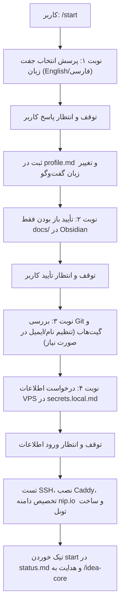
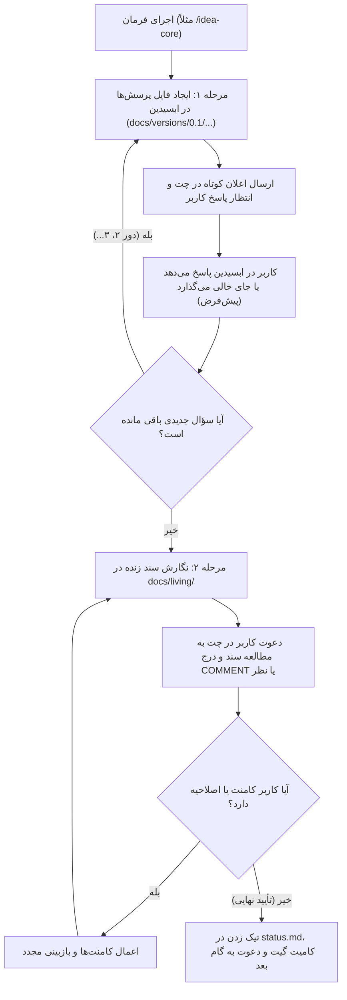

# V7.3 — تحلیل اشکال اول تمرین منتورا: تعامل تک‌پرسشی و انتخاب زبان در /start

> **بازبینی بعدی:** این فایل تحلیل و ادعای اجرای اولیه را ثبت می‌کند. ممیزی بعدی نشان داد بعضی اصلاحات ناقص یا متناقض بوده‌اند؛ نتیجه و اصلاحات تکمیلی در [03-verification.md](03-verification.md) ثبت می‌شوند. قاعدهٔ تک‌پرسشی در چت فقط برای `/start` است؛ چرخهٔ پرسش و بازبینی همهٔ گام‌های بعدی در ابسیدین انجام می‌شود.

> **ورودی:** [01-transcription.md](01-transcription.md) — گزارش اشکال اول از تمرین `mentoraAgent` در تاریخ ۲۰۲۶-۱۱-۰۳.  
> **دامنه:** بستهٔ کدو ایجنت (`workshops/public-agent/codo`)، کتاب راهنما (`workshops/public-agent/book`) و مخزن تمرین فعال (`../konkooria/mentoraAgent/`).  
> **وضعیت:** تحلیل و اعمال اصلاحات در کدو، کتاب و مخزن تمرین.

---

## ۱. خلاصهٔ یافته و ریشهٔ مسئله

در اجرای دستور `/start` توسط مدل در ابزار Antigravity روی مخزن تمرین دوم (`mentoraAgent`)، دو نقص اساسی مشاهده شد:

| ردیف | رفتار مشاهده‌شده | رفتار مورد انتظار کاربر | علت ریشه‌ای در کدو و مستندات |
|---|---|---|---|
| **۱** | مدل ۳ گام مختلف (تأیید ابسیدین، وضعیت گیت، و اطلاعات سرور) را در یک نوبت پیام تجمیع و ارسال کرد. | دستیار باید **در هر نوبت فقط یک سؤال** بپرسد، متوقف شود و منتظر پاسخ بماند. | در `docs/commands/start.md` دستورالعمل‌ها به صورت فهرست متوالی (`sequential checks`) آمده بودند اما هیچ شرط توقف صریحی مبنی بر «در هر نوبت فقط یک سؤال بپرس و متوقف شو» به مدل داده نشده بود. |
| **۲** | هیچ سؤالی دربارهٔ زبان مطرح نشد و دستیار مستقیماً سراغ مخزن ابسیدین رفت. | گام اول باید با **انتخاب زبان‌های گفت‌وگو و مستندات** آغاز شود و پروندهٔ پروژه (`profile.md`) تشکیل گردد. | در بازنویسی کدو ایجنت (نسخهٔ ۷.۲)، بر خلاف نسخهٔ وب، مرحلهٔ زبان و فایل `docs/profile.md` جا افتاده بود و دستور `/start` مستقیماً از بررسی ابسیدین شروع می‌شد. |

---

## ۲. قاعدهٔ اساسی تعامل: تک‌پرسشی (Single-Question Turn Invariant)

انباشتن چندین پرسش یا درخواست در یک پیام باعث سردرگمی کاربر، نادیده گرفته شدن برخی سؤالات و مخدوش شدن ترتیب اجرای گام‌های راه‌اندازی می‌شود.

### اصل معماری
- **تعریف قاعده:** در تمام دستورهای تعاملی کدو (نظیر `/start`، `/idea-core` و دورهای مصاحبهٔ کشف نیازها)، دستیار موظف است **در هر نوبت گفت‌وگو فقط و فقط یک پرسش یا یک درخواست تأیید** مطرح کند و بلافاصله خروجی خود را پایان دهد تا کاربر پاسخ دهد.
- **ممنوعیت تجمیع گام‌ها:** مدل مجاز نیست پیش از دریافت پاسخ یک گام، وارد گام بعدی شود یا گام‌های نیازمند اقدام کاربر را یک‌جا تولید کند.

---

## ۳. بازطراحی توالی گام‌های `/start`

با اصلاحات اعمال‌شده، چرخهٔ اجرای `/start` به ساختار قطعی زیر تغییر می‌یابد:



### جزییات پرسش زبان (Step 1)
انتخاب از میان ۳ گزینهٔ استاندارد:
```
۱. English · فارسی  (پیشنهاد ما — گفت‌وگو انگلیسی، مستندات فارسی)
۲. فارسی · فارسی  (گفت‌وگو فارسی، مستندات فارسی)
۳. English · English  (گفت‌وگو انگلیسی، مستندات انگلیسی)
```
انتخاب بلافاصله در پروندهٔ پروژه (`docs/profile.md`) ذخیره شده و زبان پاسخ‌های بعدی دستیار متناسب با آن تنظیم می‌شود.

---

## ۴. اقدامات و تغییرات اعمال‌شده

۱. **کدو (`workshops/public-agent/codo/`):**
   - ایجاد فایل ساختار پروندهٔ پروژه: `docs/profile.md`.
   - بازنویسی کامل `docs/commands/start.md` با افزودن قاعدهٔ صریح تک‌پرسشی و تفکیک نوبت‌ها با تأکید بر STOP and WAIT.
   - ارتقای `AGENTS.md`، `CLAUDE.md`، `GEMINI.md` با الزام دستیار به پرسیدن یک سؤال در هر نوبت.
   - افزودن قاعده به قانون اساسی: `docs/constitution/01-rules.md`.
   - به‌روزرسانی `README.md` جهت ارجاع به `docs/profile.md`.

۲. **کتاب کارگاه (`workshops/public-agent/book/`):**
   - به‌روزرسانی فصل ۴ (`04-start.md`) جهت تشریح دقیق پرسش‌های گام‌به‌گام `/start` (زبان‌ها، ابسیدین، گیت، سرور).
   - افزودن توضیح پروندهٔ پروژه (`docs/profile.md`) و چرایی تعامل تک‌پرسشی.

۳. **همگام‌سازی با مخزن تمرین جاری (`../konkooria/mentoraAgent/`):**
   - همگام‌سازی مستقیم فایل‌های `docs/commands/start.md`، `.agents/skills/start/SKILL.md`، `.claude/commands/start.md`، `.opencode/commands/start.md`، `docs/profile.md`، `AGENTS.md` و قانون اساسی در مخزن تمرین منتورا، تا دستیار در ادامهٔ تمرین دقیقاً بر اساس دستورالعمل جدید عمل کند.

۴. **ارتقای نسخهٔ پکیج‌ها به ۷.۳:**
   - تغییر نسخه در اسکریپت ساخت پکیج (`scripts/build_codo.py`) به `CODO_VERSION = "7.3"`.
   - ساخت مجدد پکیج‌ها: `codo-7.3.zip` و `codo-agent-7.3.zip` در مسیر `workshops/public-agent/dist/`.
   - به‌روزرسانی برچسب نسخه در `README.md` و کتاب کارگاه (`00-index.md`).

---

## ۵. تحلیل اشکال دوم: نصب خودکار کلید SSH بر پایهٔ رمز عبور اولیه سرور

### صورت مسئله و ریشهٔ فنی
در تمرین فعلی، مجری شخصاً کلید SSH را از قبل روی سرور تنظیم کرده بود؛ اما شرکت‌کنندگان عادی کارگاه چنین دانش و مهارتی ندارند. شرکت‌کننده پس از خرید سرور اوبونتو ۲۴.۰۴، صرفاً یک نشانی آی‌پی (`SERVER_IP`) و یک رمز عبور اولیهٔ روت (`SERVER_SSH_PASSWORD`) از طریق ایمیل یا پنل دریافت می‌کند.

اگر در دستور `/start` دستیار از کاربر مسیر کلید بخواهد یا مستقیماً دستور `ssh -o BatchMode=yes ...` را اجرا کند:
۱. اتصال SSH ناموفق خواهد شد، زیرا اتصال‌های غیرتعاملی (`BatchMode=yes`) درخواست رمز عبور نمی‌کنند و در صورت نبود کلید در `~/.ssh/authorized_keys` فوراً با خطای `Permission denied (publickey)` متوقف می‌شوند.
۲. تونل معکوس وب‌هوک در پس‌زمینه (`ssh -N -R 8000:localhost:8000 ...`) و استقرار خودکار در `/deploy` نمی‌توانند با رمز عبور کار کنند و نیاز به احراز هویت بدون رمز با کلید SSH دارند.

### اصل معماری: قاعدهٔ تبدیل امن رمز به کلید (Password-to-Key Bootstrap Invariant)
- دستیار در نوبت ۴ دستور `/start` صرفاً نشانی آی‌پی سرور و رمز عبور اولیهٔ `root` را دریافت می‌کند.
- دستیار موظف است خود به صورت خودکار:
  ۱. وجود کلید محلی SSH را بررسی کند و در صورت عدم وجود، یک جفت کلید امن جدید بسازد (`ssh-keygen -t ed25519 -N "" -f ~/.ssh/id_ed25519`).
  ۲. بررسی کند آیا اتصال بر پایهٔ کلید هم‌اکنون کار می‌کند یا خیر (`ssh -o BatchMode=yes ...`).
  ۳. در صورت عدم وجود کلید روی سرور، با استفاده از رمز عبور ارائه‌شده، کلید عمومی محلی را روی سرور کپی و به `~/.ssh/authorized_keys` اضافه کند (از طریق `sshpass` یا اسکریپت خودکار پایتون با `paramiko`).
  ۴. اتصال بدون رمز را مجدداً با `ssh -o BatchMode=yes` آزموده و ثبت نماید.
- از این مرحله به بعد، هیچ فرمانی به رمز عبور سرور وابسته نخواهد بود.

---

## ۶. تحلیل اشکال سوم: تفکیک مرز گفت‌وگو و ابسیدین و چرخهٔ بازگشتی بازبینی (The Specification & Comment Loop)

### صورت مسئله و ریشهٔ رفتار مدل
در اجرای فرمان `/idea-core`، مدل هوش مصنوعی سؤالات مربوط به هستهٔ ایده را مستقیماً در پنجرهٔ گفت‌وگو (چت) از کاربر پرسید و چرخهٔ رفت‌وبرگشت استاندارد کدو را نادیده گرفت.
ریشهٔ این رفتار، عبارت گمراه‌کنندهٔ «Conduct a focused, multi-round interview in Persian» در فایل `docs/commands/idea-core.md` و فقدان منع صریح طرح پرسش‌ها در چت بود.

### اصل بنیادین کدو: تفکیک وظایف چت و ابسیدین
در معماری متنی و هدایت‌شدهٔ کدو (Document-Driven):
۱. **پنجرهٔ چت منحصراً برای دستور `/start` است:** فقط در گام اول که زیرساخت فنی، زبان‌ها و اتصال SSH تنظیم می‌شود، پرسش‌ها به صورت تعاملی تک‌پرسشی در چت انجام می‌پذیرد.
۲. **تمام گام‌های مفهومی و طراحی در ابسیدین انجام می‌شوند:** از گام `/idea-core` به بعد (`/prd`، `/tools`، `/sops`، `/data-model`، `/capabilities`، `/edge-cases` و بازبینی `/plan`)، دستیار **هرگز مجاز نیست پرسش‌های مصاحبه را در پنجرهٔ چت مطرح کند**. پنجرهٔ چت فقط برای ارسال اعلان‌های کوتاه ۳ خطی (هدایت کاربر به فایل ابسیدین و گزارش پیشرفت) است.

### چرخهٔ بازگشتی دومرحله‌ای مستندسازی (The Specification & Comment Loop)
هر گام مفهومی در کدو از یک چرخهٔ مشخص و قطعی عبور می‌کند:



#### مرحلهٔ ۱: چرخهٔ پرسش‌ها (The Question Loop)
- دستیار سؤالات ساخت‌یافته را همراه با «چرا مهم است:»، گزینه‌های روشن با علامت «— پیشنهادِ ما»، و جای خالی `**پاسخِ شما:**` درون فایل نسخهٔ جاری (مثلاً `docs/versions/0.1/01-idea-core-questions.md`) می‌نویسد.
- دستیار در چت فقط می‌گوید فایل آماده است و منتظر می‌ماند.
- کاربر در ابسیدین پاسخ می‌دهد؛ **جای خالی یعنی پذیرش گزینهٔ «پیشنهادِ ما»**.
- کاربر در چت می‌گوید «پاسخ دادم» / «done» / «۱».
- اگر پاسخی نیازمند شفاف‌سازی باشد، دستیار `## دور ۲` را به همان فایل اضافه می‌کند و چرخه تکرار می‌شود تا **هیچ سؤالی باقی نماند**.

#### مرحلهٔ ۲: چرخهٔ بازبینی و کامنت روی سند زنده (The Living Doc & Comment Loop)
- پس از اتمام سؤالات، دستیار سند زنده را در `docs/living/` (مثلاً `docs/living/prd.md`) می‌نویسد.
- دستیار در چت کاربر را دعوت می‌کند تا سند را در ابسیدین بخواند و در صورت نیاز، مستقیماً به عنوان **COMMENT** یا **نظر** در فایل یادداشت بگذارد (یا در چت بگوید).
- دستیار کامنت‌ها را اعمال می‌کند، بررسی می‌کند که آیا سؤال جدیدی ایجاد شده یا خیر، و سند را به‌روز می‌کند.
- این رفت‌وبرگشت تا زمانی ادامه می‌یابد که **هیچ سؤالی و هیچ کامنت اعمال‌نشده‌ای باقی نماند**.

#### مرحلهٔ ۳: انتقال به گام بعد
- گام در `docs/status.md` تیک می‌خورد.
- تغییرات در گیت کامیت می‌شوند.
- در چت، کاربر به اجرای دستور گام بعدی (مثلاً `/prd`) دعوت می‌شود.

### اقدامات اصلاحی
- اصلاح `AGENTS.md`، `CLAUDE.md`، `GEMINI.md` و قانون اساسی (`01-rules.md`).
- بازنویسی کامل `docs/commands/idea-core.md` و شفاف‌سازی فرایند دورهای پرسش و کامنت در سایر دستورهای مستندسازی (`prd.md`، `tools.md`، `sops.md`، `data-model.md`، `capabilities.md`، `edge-cases.md`).
- به‌روزرسانی فصل ۵ کتاب (`05-product-design.md`) در تشریح چرخهٔ پرسش‌ها، پیش‌فرض‌ها و کامنت‌گذاری.


