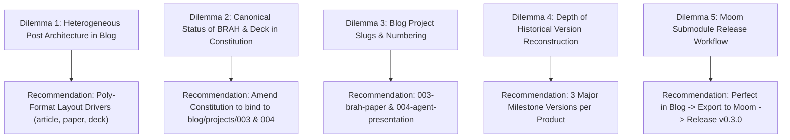
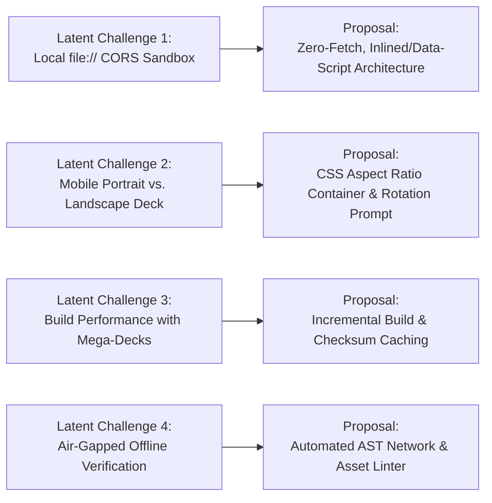

# V9.1 — Architectural Analysis: Product Consolidation, Blog Migration, and Moom Job Extraction

**Source Document:** [01-transcription.md](file:///home/omid/projects/workshop/workshop_docs/versions/V9.1/01-transcription.md)  
**Parent Frameworks:** [Workshop Constitution](../../CONSTITUTION.md), [V9.0 Moom Implementation](../V9.0/06-moom-implementation.md), [V9.0 Analysis Series](../V9.0/02-analysis.md)  
**Scope:** Evaluates the transition of `paper/` and `presentation/` into `blog/`, the upgrade of `blog/` to Moom v0.2.1+, the overhaul of Moom's starter jobs (`presentation-maker` and `blog-publisher`), and ecosystem-wide implications.

---

## 1. Executive Summary & Vision

In V9.0, the ecosystem established **Moom** (`https://github.com/gonbad/moom`, release `v0.2.1`) as an independent product tracked via Git submodule at `moom/`. Moom introduced the single-job Kandoo model, standard Anthropic-compatible Agent Skills under `job/<name>/`, authoritative state in `workspace.json`, a modular engine in `.moom/core/`, and an embedded starter catalog in `registry/`.

In **V9.1**, the creator directs four major systemic moves:
1. **Product Consolidation:** Retire the standalone root products `paper/` (BRAH Paper v6.2) and `presentation/` (the 167-slide Agent Presentation deck), converting them into two native posts within `blog/`.
2. **Kandoo Upgrade:** Migrate `blog/` from its obsolete V8.0 monolithic script (`blog/moom.py`, 47 KB) and legacy layout to the pristine V9.0 Moom engine.
3. **Historical Rationale Preservation:** Extract the design rationales, architectural evolution, and decision records of the paper and presentation from Workshop history, structuring them as versioned dossiers inside their respective blog projects as if they were natively authored through Moom.
4. **Job Extraction for Moom:** Extract and curate two robust, production-grade Jobs into Moom's `registry/`:
   - **`blog-publisher`:** A multi-post publishing engine capable of rendering diverse post formats (articles, papers, slides, interactive tools) alongside a root index.
   - **`presentation-maker`:** A purpose-built, horizontal (landscape-first) slide deck engine engineered exclusively for offline local delivery (zero server installation), featuring keyboard navigation, an overview slide-selector grid, and responsive display.

```mermaid
flowchart TD
    subgraph Legacy Root Structure
        OldPaper["paper/ (BRAH v6.2)"]
        OldDeck["presentation/ (167 Slides)"]
    end

    subgraph Blog Kandoo (Upgraded to Moom Engine)
        BlogEngine[".moom/core/ + workspace.json"]
        Post0["projects/000-index/"]
        Post1["projects/001-workshop-7/"]
        Post2["projects/002-claude-server/"]
        Post3["projects/003-brah-paper/"]
        Post4["projects/004-agent-presentation/"]
    end

    subgraph Moom Submodule (moom/)
        Registry["registry/ (Starter Catalog)"]
        JobBlog["registry/blog-publisher/ (New)"]
        JobPres["registry/presentation-maker/ (Overhauled)"]
    end

    OldPaper -->|"Ingest & Reconstruct History"| Post3
    OldDeck -->|"Ingest & Reconstruct History"| Post4
    BlogKandooStructure["Refined Blog Workflow"] -->|"Extract Job"| JobBlog
    DeckLessons["Presentation Engine Invariants"] -->|"Rebuild Starter Recipe"| JobPres
```

---

## 2. Creator Decisions & Honest Critiques

### Decision 1: Absorbing `paper/` and `presentation/` into `blog/` and Pruning Root Products

* **Creator's Intent:** Reduce repository sprawl at the root level of Workshop. Rather than maintaining separate top-level directories for the paper and presentation, treat them as two specialized publications inside the workshop blog.
* **Critique & Strengths:**
  * **Dogfooding Validation:** This is a strong practical test of Moom and the blog architecture. If the blog can comfortably host an academic paper and a massive 167-slide interactive presentation deck without breaking its build or navigation model, the blog architecture is proven versatile.
  * **Unified Distribution:** The workshop gains a single deployment pipeline (VPS web deploy + automated offline ZIP generation) for all educational deliverables.
* **Risks & Critiques:**
  * **Constitutional Hierarchy Inversion:** In the [Workshop Constitution](../../CONSTITUTION.md#L78-L84) (Section 3: *The Synchronization Law*), the BRAH Paper and Presentation Deck are designated as the **binding architectural ground truth** governing all public and private agents. Demoting them to "blog posts" risks blurring their constitutional authority. If an agent inspects the repository, it may treat a blog post as an informal article rather than inviolable system law.  
    *Mitigation:* The Constitution must explicitly state that `blog/projects/003-brah-paper` and `blog/projects/004-agent-presentation` are the canonical repositories of the binding architectural standards. **COMMENT**:  the workhop is not about agents anymore. so we should update the constitution
  * **Deliverable Format Divergence:** Posts 001 and 002 are vertical-scrolling web pages. A 167-slide horizontal presentation and an A4-formatted academic paper cannot be forced into a standard blog article template without destroying their usability and pedagogical value. They must retain their distinct rendering runtimes. **COMMENT**: we dont need to unify their styles. we chose this over wordpress to be free of unifying
  * **Asset & Repository Weight:** `presentation/` contains interactive simulations, complex SVG assets, and heavy datasets (`deck-data.js` 288 KB, `tickets.js` 148 KB). Moving these into `blog/` means a full blog build could become slow if not engineered with modular, per-project caching. **COMMENT**: each blog post should be compiled to minimized html dist. we deploy only dist

---

### Decision 2: Upgrading `blog/` to the Latest Moom Engine (v0.2.1+)

* **Creator's Intent:** `blog/` was the initial prototype workspace built in V8.0. It still runs on an obsolete, pre-release engine (`blog/moom.py` is a 47 KB monolith, using `blog/docs/job/procedures/` and legacy state conventions). It must be refactored to use the modern Moom v0.2.1 layout.
* **Critique & Strengths:**
  * **Imperative Alignment:** Keeping `blog/` on the obsolete V8.0 script while developing Moom v0.2.1 in `moom/` created severe technical debt and divergent documentation. Upgrading `blog/` makes it a true, compliant **Kandoo**.
  * **Adoption of Clean Structure:** Moves machine-executable skills out of `docs/` and into `blog/job/<name>/`, establishes authoritative state in `blog/workspace.json`, and routes execution through the lightweight trampoline `blog/moom.py` pointing to `blog/.moom/core/moom.py`.
* **Risks & Critiques:**
  * **The "One Job per Kandoo" Reality Check:** In V9.0 ([04-analysis-round-3.md](../V9.0/04-analysis-round-3.md#L23-L31)), it was decided that a Kandoo contains **exactly one active Job**. In `blog/`, that Job is `blog-publisher`. If `blog-publisher` is the active Job, how does it manage heterogeneous posts (slides vs. papers vs. tutorials)?  
    If the Job assumes every post is produced by the same markdown-to-HTML pipeline, it will fail when building the BRAH paper or the Agent Presentation.  **COMMENT**: why fail? they only differ in style. the workflow is quite the same
    *Resolution:* The `blog-publisher` Job must define an **orchestration workflow** (metadata, aggregation, previewing, verification, packaging, deployment) while allowing each project's `site/` to use a declared **Layout Driver** (`article`, `presentation`, `paper`, or `custom`). **COMMENT**: OK. we dont need to standaardize layout driver. each post should define its layout in `/layout` step.

---

### Decision 3: Reconstructing Historical Rationale as Moom Project Versions

* **Creator's Intent:** Extract the historical context, transcripts, architectural analyses, and review decisions for the paper and presentation across past Workshop versions (V6.0 through V8.0), and organize them in `docs/projects/<id>/versions/` as if they were natively developed inside Moom. If gaps in Moom's methodology appear during this reconstruction, improve Moom.
* **Critique & Strengths:**
  * **Exceptional Architectural Traceability:** Rebuilding the rationale preserves *why* the BRAH invariants exist (CIA-by-Design, split authority, LLM-Zero completeness) and *why* the presentation was restructured into 5 parts.
  * **Stress-Testing Moom's Version Model:** Forcing Moom's versioning schema (`01-input.md`, `001-review.md`, status ledger) onto existing complex products immediately highlights where Moom's documentation conventions are too rigid or need refinement.
* **Risks & Critiques:**
  * **Trap of Revisionist Fiction:** Generating synthetic questionnaire responses for past work can easily devolve into artificial busywork.  
    *Rule:* Reconstructed versions must draw strictly from real historical files (e.g., `workshop_docs/versions/V6.0.3/` for BRAH; `presentation-archive/` and `workshop_docs/versions/V7.4/` for the presentation). Historical milestones should be documented faithfully rather than fabricated. **COMMENT**: OK. and each archived presentation should be a post too.
  * **Milestone Granularity:** The presentation evolved across more than 10 drafts. Reconstructing 10 separate Moom version folders would clutter the blog. It is far more effective to distill the evolution into **3 seminal milestones** per product. **COMMENT**: write in moom rules that version docs should not be read by AI except I explicitly say or it's the latest version.

---

### Decision 4: Extracting Two Standalone Jobs into Moom's Catalog

* **Creator's Intent:** Add two polished, reusable Jobs to Moom:
  1. `blog-publisher`: Multi-post website with an index page, adaptable to different post layouts.
  2. `presentation-maker`: Pure horizontal (landscape default) presentation deck, responsive, Left/Right arrow navigation, overview grid button, keyboard shortcuts, strictly offline deliverable (folder/ZIP with `index.html`), never server-hosted.
* **Critique & Strengths:**
  * **Addresses Real Use Cases:** Most professionals using AI need either a clean way to publish documentation/journals or a reliable, friction-free way to produce offline keynote/meeting decks.
  * **Separation of Presentation from Web Publishing:** Emphasizing that a presentation deck is an **offline deliverable** rather than a web application is brilliant. Presentations are shown in meeting rooms, auditoriums, and offline settings where internet reliability is poor and server deployment is unnecessary overhead.

---

### Decision 5: Honest Critique of Existing `moom/registry/presentation-maker/`

The creator noted that an AI generated the current `presentation-maker` starter recipe in V9.0 without explicit direction, and requested an honest audit:

```
Verdict: FUNDAMENTALLY FLAWED & UNACCEPTABLE.
It violates the core requirements of a true presentation tool and must be thoroughly replaced.
```

#### Detailed Breakdown of Flaws in Current `presentation-maker`:
1. **Vertical Scrolling Instead of Horizontal Slides:**  
   In `moom/registry/presentation-maker/scripts/render.py` (lines 51–53):
   ```css
   html { scroll-snap-type: y proximity; }
   section { min-height: 100vh; padding: 8vh 8vw; }
   ```
   The deck scrolls **vertically** down the page! It renders Up (`↑`) and Down (`↓`) navigation buttons. This is an article reader, not a presentation deck. A presentation requires a horizontal viewport (`16:9` aspect ratio) with slide transitions.
2. **Absence of an Overview / Slide Sorter Grid:**  
   There is zero capability to zoom out, view thumbnail tiles of all slides, or jump directly to slide 42. In a real presentation with 50+ slides, sequential clicking is unusable.
3. **Crude, Constrained Content Model:**  
   The renderer enforces a strict JSON schema:
   ```json
   { "title": "string", "slides": [ { "title": "string", "body": "string", "source_note": "string" } ] }
   ```
   Real presentation slides require varied visual structures: two-column comparisons, bulleted checklists, full-bleed images, code blocks with syntax highlighting, KPI callouts, and interactive diagrams. Flat title + body strings make professional decks impossible.
4. **Broken Directionality in RTL:**  
   While `render.py` takes `direction="rtl"`, keyboard navigation maps `ArrowRight` and `ArrowDown` to forward indiscriminately. In standard Persian/Arabic RTL slide decks, the spatial progression is inverted: `ArrowLeft` advances, while `ArrowRight` goes back.
5. **No Presenter Facilitation Tools:**  
   No fullscreen trigger (`F`), no speaker notes modal (`N`), and no progress bar.

---

## 3. What is Yet to Be Decided (Open Dilemmas & Recommendations)



### Dilemma 1: How Does `blog-publisher` Handle Heterogeneous Post Formats?
* **Problem:** If `blog-publisher` defines a single rendering script, it will fail because Post 001 is vertical interactive slides, Post 002 is a 12-scene terminal walkthrough, Post 003 is an academic paper, and Post 004 is a 167-slide horizontal deck.
* **Options:**
  * *Option A (Homogeneous):* Force all blog posts into standard Markdown articles. (Destroys existing content).
  * *Option B (Post-Specific Invariant):* Let each post keep its own self-contained build/site directory, while `blog-publisher` governs workspace coordination, project state, the root index aggregator, local previewing, and deployment.
* **Recommendation:** **Option B (Poly-Format Site Model).**  
  Each project declares its layout format in `project.json` (e.g. `"driver": "article" | "presentation" | "paper" | "interactive"`). The `blog-publisher` Job manages index compilation, RSS/manifest generation, verification gates, and deployment, while dispatching to the appropriate build helper.

---

### Dilemma 2: Constitutional Invariant Anchoring Post-Demotion
* **Problem:** Removing `paper/` and `presentation/` from the root directory breaks existing absolute paths and citations in `workshops/public-agent/`, `registration/`, and `CONSTITUTION.md`.
* **Options:**
  * *Option A:* Leave symbolic links at root (`paper -> blog/projects/003-brah-paper/site`).
  * *Option B:* Amend `CONSTITUTION.md` and update all paths across the repo to reference the new canonical locations.
* **Recommendation:** **Option B with temporary transitional redirects.**  
  Amend `CONSTITUTION.md` to formalize that the BRAH Paper v6.2 and the Agent Presentation are housed under `blog/projects/003-brah-paper/` and `blog/projects/004-agent-presentation/`. Replace the root directories with simple HTML redirect stubs during V9.1 so external bookmarks or older notes don't hit 404s. Remove root `presentation.zip` (7.5 MB) from git tracking and move it into the blog release artifact folder.
**COMMENT**: none. amend constitution so that the paper and the presentation are not important anymore.
---

### Dilemma 3: Project Slugs and Numbering in `blog/`
* **Problem:** What IDs should be assigned to the migrated products?
* **Recommendation:**
  * `blog/projects/003-brah-paper/`: Dedicated to the academic paper.
  * `blog/projects/004-agent-presentation/`: Dedicated to the 167-slide deck.
  This maintains clean sequential ordering (`000-index`, `001-workshop-7`, `002-claude-server`, `003-brah-paper`, `004-agent-presentation`).

---

### Dilemma 4: Milestone Granularity for Historical Reconstruction
* **Problem:** How many version folders should be created in `docs/projects/003-*/versions/` and `004-*/versions/`?
* **Recommendation:** Group into **Three Core Milestone Versions** each:
  * **For BRAH Paper (`003-brah-paper`):**
    1. `V1.0`: Initial security analysis and threat model (extracted from V6.0.3 design reviews).
    2. `V2.0`: Formal BRAH v6.2 specification with CIA theorems and mathematical proofs (extracted from V6.2 HTML release).
    3. `V2.1`: Blog adaptation and responsive styling under Moom.
  * **For Agent Presentation (`004-agent-presentation`):**
    1. `V1.0`: Early 3-deck split (V7.0 architecture).
    2. `V2.0`: Comprehensive 167-slide structural rewrite across five chapters (V7.4 milestone).
    3. `V2.1`: Integration into Blog Kandoo with offline packaging and local index integration.
**COMMENT**: no. keep entire history
---

### Dilemma 5: Moom Submodule Workflow & Release Cadence
* **Problem:** How to develop the new jobs without breaking the detached submodule `moom/`?
* **Recommendation:**
  1. Complete the migration and refinement of `blog/` first.
  2. Refactor and test the new `presentation-maker` engine.
  3. Package both verified jobs into `moom/registry/`.
  4. Run `moom/tests/test_lifecycle.py` and `tools/release.py --check`.
  5. Tag and publish Moom **v0.3.0** on GitHub (`gonbad/moom`).
  6. Update Workshop's Git submodule pointer to track `v0.3.0`.

---

## 4. What is Yet to Be Thought Of (Latent Challenges & Proposals)



### Latent Challenge 1: The Local `file://` CORS Sandbox Trap
* **The Trap:** The creator explicitly mandates that the presentation deck **must be delivered as an offline folder/ZIP where clicking `index.html` runs locally without a web server**.  
  In modern web browsers (Chrome, Edge, Safari, Firefox), opening a file via `file://` enforces strict sandboxing:
  * Any `fetch()` or `XMLHttpRequest` to local JSON files (`fetch('./slides.json')`) is **blocked by CORS**!
  * JavaScript ES modules (`<script type="module">`) are blocked or restricted under `file://` in several environments.
  If a developer naively builds `presentation-maker` around `fetch("slides.json")`, the presentation will show a blank white screen when double-clicked by an offline user!
* **Proposal:** **The Zero-Fetch / Script-Data Invariant.**  
  All slide content, themes, and logic must be loaded either:
  1. Directly inlined into a self-contained `index.html`, OR
  2. Loaded via standard script tags declaring data on a namespace:
     ```html
     <script src="deck-data.js"></script>
     <script src="deck-engine.js"></script>
     ```
     Where `deck-data.js` simply sets `window.DECK_DATA = { ... };`. This guarantees 100% functionality on any OS when opened directly via `file://`.

---

### Latent Challenge 2: Mobile Viewport vs. Landscape Presentation
* **The Trap:** The creator requires: *"It must only be horizontal, but responsive so we can view it on phones too, but default horizontal."*  
  On mobile devices held in portrait mode, a fixed horizontal 16:9 canvas either shrinks to unreadable micro-text or overflows horizontally, causing awkward scrolling.
* **Proposal:** **Smart Aspect-Ratio Container with Rotation Guidance:**
  * Implement an aspect-ratio container (`aspect-ratio: 16 / 9`) with dynamic CSS viewport units (`min(100vw, 177.78vh)`).
  * In portrait mode (`@media (orientation: portrait)`), display a non-intrusive rotation hint overlay ("Rotate your device for presentation view") while scaling the slide container to fit the screen width cleanly. **COMMENT**: agreed
  * Support touch swipe gestures (Swipe Left = Next, Swipe Right = Prev in LTR; mirrored in RTL). **COMMENT**: yes.

---

### Latent Challenge 3: Blog Build Times & Artifact Weight
* **The Trap:** `004-agent-presentation` has dozens of scripts, styles, and interactive widgets. If `python3 blog/moom.py run build` parses, validates, and zips all 167 slides on every invocation, authoring simple blog posts will become sluggish.
* **Proposal:** **Targeted Builds & Artifact Checksums:**
  * Enhance the build command to accept an optional project target:  
    `python3 blog/moom.py run build --project 001-workshop-7`
  * Compute checksums of `site/` files in `project.json`. If a project's source hasn't changed, skip re-generating its offline ZIP during global builds.

---

### Latent Challenge 4: Air-Gapped Verification (Zero Remote Leaks)
* **The Trap:** Presentation authors or blog creators often accidentally include external fonts (`fonts.googleapis.com`), CDN libraries (`cdn.jsdelivr.net`), or analytics scripts. When an attendee opens the deck offline on an airplane, assets fail to load or the page hangs.
* **Proposal:** **Automated Offline Asset Linter:**  
  Add an automated check in `scripts/check.py` for both Jobs:
  * Scans all generated HTML/CSS/JS files for `http://` or `https://` URLs in `<link>`, `<script>`, ``, and `@import`.
  * Fails the build if any non-local asset dependency is detected.

---

## 5. Architectural Enhancements to the Idea

### Enhancement 1: The Next-Generation Moom Presentation Engine (`deck-engine`)

We propose replacing the flawed `presentation-maker` with a lightweight, zero-dependency presentation runtime inspired by the best features of reveal.js, Marp, and Workshop's active deck:

```
┌────────────────────────────────────────────────────────────────────────┐
│                   MOOM PRESENTATION RUNTIME ARCHITECTURE               │
├────────────────────────────────────────────────────────────────────────┤
│  Keyboard & Touch Nav (←, →, Space, PageUp/Down, Swipe)                │
│  [G] Slide Overview Grid Modal  │  [N] Speaker Notes Drawer            │
│  [F] Fullscreen Toggle          │  [H] Toggle UI Controls              │
├────────────────────────────────────────────────────────────────────────┤
│  Aspect Ratio Viewport: 16:9 Responsive Canvas (Scale-to-fit)          │
│  Slide Layout Templates: Cover, Title+Body, 2-Column, Split-Media, Code│
├────────────────────────────────────────────────────────────────────────┤
│  Persistence: Current slide index saved in sessionStorage / #hash     │
│  Zero-CORS: Pure offline execution under file:// protocol              │
└────────────────────────────────────────────────────────────────────────┘
```

#### Key Capabilities of the New Presentation Engine:
1. **Slide Overview Grid (`G` Key or Grid Button):**  
   Clicking the grid icon or pressing `G` displays a modal lightbox showing miniature card previews of every slide in the deck. The presenter can search by slide title or number and click to jump instantly.
2. **Speaker Notes Drawer (`N` Key):**  
   Pressing `N` opens a floating, non-intrusive drawer showing private presenter notes, talking points, and pacing cues for the active slide.
3. **Bi-directional LTR/RTL Keyboard Semantics:**  
   When `dir="rtl"` is set, navigation logically respects reading flow: `ArrowLeft` advances to the next slide, and `ArrowRight` returns to the previous slide.
4. **Markdown-Based Authoring:**  
   Instead of editing awkward JSON strings, authors write `slides.md` using standard markdown separators (`---` for slides, `???` for speaker notes). A fast Python script (`scripts/render.py`) compiles `slides.md` into the standalone `index.html`.

---

### Enhancement 2: The Polymorphic Blog Architecture (`blog-publisher`)

Formalize `blog/` as a general-purpose publishing Kandoo with first-class support for diverse content formats:

```
blog/
├── projects/
│   ├── 000-index/              # Publication catalog, feed, and landing page
│   ├── 001-workshop-7/         # Interactive vertical-slide post
│   ├── 002-claude-server/      # Step-by-step tutorial post
│   ├── 003-brah-paper/         # Academic formal paper (A4 layout, theorems)
│   └── 004-agent-presentation/ # 167-slide horizontal presentation deck
├── job/blog-publisher/         # The active single Job
│   ├── SKILL.md                # Blog publishing workflow contract
│   ├── procedures/             # brief, content, verify, build, package, deploy
│   └── scripts/
│       ├── build_index.py      # Aggregates project metadata into 000-index
│       ├── package_zips.py     # Generates clean, standalone offline ZIPs
│       ├── verify_offline.py   # Checks zero-remote-leak invariant
│       └── deploy_vps.py       # Deploys static tree to Caddy on the VPS
├── workspace.json              # Canonical Kandoo state
└── moom.py                     # Trampoline runner to .moom/core/
```

---

### Enhancement 3: The "Moom Ingest" Protocol for Legacy Codebases

To address the creator's instruction (*"if during this we realize Moom has deficiencies, we should fix Moom"*), we define a standardized **Moom Ingestion Workflow** (`moom-ingest`):

When adopting an existing standalone artifact into Moom:
1. **Intake & Snapshot:** Copy existing source files into `projects/<id>/site/` and take an immutable SHA256 checksum snapshot in `project.json`.
2. **Dossier Extraction:** Scan git logs and historical notes for the major design pivots. Create `docs/projects/<id>/versions/V1.0/`, `V2.0/`, etc.
3. **Fidelity Verification:** Verify that the ingested artifact renders identically to the legacy source before applying any Moom modifications.
4. **Adapter Hooking:** Connect the project to the Kandoo's build and offline packaging pipeline.

---

## 6. Comprehensive V9.1 Implementation Plan

```mermaid
flowchart TD
    subgraph Phase 1: Blog Engine Migration
        P1A["Clean up blog/ directory"] --> P1B["Install modern .moom/core/ & workspace.json"]
        P1B --> P1C["Set active job to job/blog-publisher/"]
    end

    subgraph Phase 2: Ingest Retired Products
        P2A["Ingest paper/ -> blog/projects/003-brah-paper/"]
        P2B["Ingest presentation/ -> blog/projects/004-agent-presentation/"]
        P2A --> P2C["Construct historical docs in docs/projects/003-*/versions/"]
        P2B --> P2D["Construct historical docs in docs/projects/004-*/versions/"]
    end

    subgraph Phase 3: Presentation Engine Engineering
        P3A["Design modern horizontal deck template (scripts/render.py)"]
        P3B["Implement Grid Overview [G], Notes [N], Fullscreen [F]"]
        P3C["Replace moom/registry/presentation-maker/"]
    end

    subgraph Phase 4: Job Extraction & Registry Curation
        P4A["Extract job/blog-publisher/ into moom/registry/blog-publisher/"]
        P4B["Validate both skills against Agent Skills spec"]
    end

    subgraph Phase 5: Verification & Pruning
        P5A["Run test_lifecycle.py in moom/"]
        P5B["Test blog build, preview, and packaging"]
        P5C["Prune root paper/ & presentation/ (replace with redirect stubs)"]
        P5D["Update CONSTITUTION.md & bump Moom to v0.3.0"]
    end

    Phase 1 --> Phase 2
    Phase 2 --> Phase 3
    Phase 3 --> Phase 4
    Phase 4 --> Phase 5
```

### Detailed Execution Matrix:

| Phase | Milestone | Concrete Artifacts | Success Gate |
|---|---|---|---|
| **Phase 1** | **Blog Kandoo Migration** | `blog/.moom/core/`, `blog/workspace.json`, `blog/job/blog-publisher/` | `python3 blog/moom.py status` reports valid state with Moom v0.2.1 engine. |
| **Phase 2** | **Product Ingestion** | `blog/projects/003-brah-paper/`, `blog/projects/004-agent-presentation/`, `docs/projects/003-*/`, `docs/projects/004-*/` | Paper and Presentation open in browser from `blog/projects/`; historical dossiers document V1.0, V2.0, V2.1. |
| **Phase 3** | **Overhaul Presentation Maker** | `moom/registry/presentation-maker/` (new `render.py`, template, overview modal) | Generates standalone horizontal deck with Left/Right nav, `G` grid, `N` notes, working via `file://`. |
| **Phase 4** | **Curate Blog Publisher Job** | `moom/registry/blog-publisher/` (skill, procedures, helpers) | `blog-publisher` passes skill linter and can be initialized in a fresh Moom workspace. |
| **Phase 5** | **Pruning & Release** | `paper/` & `presentation/` removed; `CONSTITUTION.md` amended; Moom tagged `v0.3.0` | All unit tests pass; root repo clean; submodule pointer updated. |

---

## 7. Conclusion & Next Step Confirmation

The creator's vision for V9.1 resolves repository fragmentation, validates Moom against the toughest possible dogfooding challenges (an academic paper and a 167-slide interactive presentation), and enriches Moom's catalog with two truly indispensable production Jobs.

With this analytical foundation established:
* The honest critique exposes the fatal flaws of the existing AI-generated `presentation-maker` and defines its replacement.
* The architectural recommendations safeguard the constitutional status of the BRAH invariants while adopting the poly-format blog design.
* The implementation plan provides a safe, phased roadmap preserving all historical evidence.

*Awaiting creator review and approval to proceed with Phase 1.*
