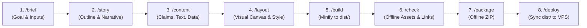

# V9.1 — Architectural Analysis (Round 2): Resolution of Controversial Topics

**Source Document:** [02-analysis.md](file:///home/omid/projects/workshop/workshop_docs/versions/V9.1/02-analysis.md) with Creator Comments  
**Scope:** Strictly resolves the controversial topics, course corrections, and specific feedback from the creator's comments. All agreed topics from Round 1 are finalized and frozen.

---

## 1. Executive Status: Consensus vs. Controversial Matrix

To keep this document concise and actionable, all topics with 100% agreement are frozen:

| Design Dimension | Status | Finalized Decision |
|---|---|---|
| **Presentation Engine Replacement** | **Closed** | Completely replace AI-generated `presentation-maker`. New engine enforces 16:9 landscape default, Left/Right arrow navigation, mobile touch swipe, aspect-ratio container with portrait rotation hint, slide overview grid modal (`G`), speaker notes drawer (`N`), and fullscreen (`F`). |
| **Offline Presentation Invariant** | **Closed** | Zero-server, zero-fetch, zero-CORS architecture. Double-clicking `index.html` runs locally under `file://` on any operating system. |
| **Blog Kandoo Migration** | **Closed** | Upgrade `blog/` to modern Moom engine layout (`.moom/core/`, `workspace.json`, single installed Job in `blog/job/blog-publisher/`). Deprecate legacy 47 KB monolithic `blog/moom.py`. |
| **Poly-Format Blog Philosophy** | **Closed** | No visual unification or WordPress-style homogeneous theme. Each post defines its own layout, scripts, and visual style independently. |
| **No Abstract Layout Drivers** | **Closed** | Rejected custom driver plugins. Posts simply declare their layout and styling within the native `/layout` production step. |
| **Minified Dist & Deployment** | **Closed** | Each post compiles to a minimized HTML `dist/`. The deployment pipeline pushes strictly the aggregated static `dist/` tree to the VPS. |

---

## 2. Topic 1: The Constitutional Paradigm Shift — Sunset of the Agent Era

### The Dilemma & Creator Feedback
Round 1 treated the BRAH Paper and Agent Presentation as inviolable supreme architectural standards governed by Section 3 (*The Synchronization Law*) of the [Workshop Constitution](../../CONSTITUTION.md#L78-L84).  
**Creator Comments:**
> *"the workshop is not about agents anymore. so we should update the constitution"* (Line 61)  
> *"none. amend constitution so that the paper and the presentation are not important anymore."* (Line 170)

### Architectural Analysis & Resolution
This clarifies the entire trajectory of the Workshop ecosystem:
1. **The Core Focus Has Shifted:** The "Public Agent Workshop" era (V6–V7) was about autonomous agent harnesses, Byzantine resilience, and Pydantic AI runtimes. The active ecosystem focus (V8–V9) is now **Moom (reproducible workflow extraction)** and the **Workshop Journal / Blog (experiential, poly-format publishing)**.
2. **Repeal of the Synchronization Law:** The BRAH Paper (`paper/`) and Agent Presentation (`presentation/`) are no longer binding architectural ground truth for the repository. They are **retired historical milestones** being preserved as case studies inside the blog.
3. **Clean Decoupling:**
   - We do **not** need root symbolic links, transitional HTTP redirects, or cross-repository invariant checks for BRAH.
   - Root `paper/` and `presentation/` will be completely pruned once ingested into `blog/`.
   - `CONSTITUTION.md` will be amended to V9.1, declaring Moom and the Workshop Journal as the primary active products, and relegating the agent harnesses to historical reference status.

---

## 3. Topic 2: Archival Depth & Ingesting Historical Decks as Blog Posts

### The Dilemma & Creator Feedback
Round 1 recommended consolidating history into three summarized milestone versions to prevent clutter.  
**Creator Comments:**
> *"OK. and each archived presentation should be a post too."* (Line 88)  
> *"no. keep entire history"* (Line 193)

### Architectural Analysis & Structure
There are **8 archived presentations** in [`presentation-archive/`](file:///home/omid/projects/workshop/presentation-archive/) plus the active deck:
1. `v7.0-presentation1` (Agent Introduction)
2. `v7.0-presentation2` (Model & Harness Architecture)
3. `v7.0-presentation3` (Product & Future of Work)
4. `pre-v7.4` (Pre-rewrite monolithic deck)
5. `v7.4-first-draft` (Opening repair draft)
6. `v7.4-before-full-rewrite` (Slide 18+ rewrite)
7. `v7.4-before-structural-revision` (Pre-structural overhaul)
8. `v7.4-before-five-part-revision` (Pre-chapter split)
9. `presentation/` (Final 167-slide, 5-part deck)

If all 8 historical decks become separate top-level blog posts in `blog/projects/000-index`, they would completely dominate the journal index and obscure other articles.

### Proposed Archival Architecture:
We satisfy both *"keep entire history"* and *"each archived presentation should be a post too"* cleanly:
1. **Primary Project:** `blog/projects/004-agent-presentation/` contains the final 167-slide deck as the flagship post.
2. **The Historical Presentation Archive Series:**
   - Rather than scattering them randomly, we ingest the historical decks as dedicated posts:
     - `projects/005-presentation-v7-0-part1/`
     - `projects/006-presentation-v7-0-part2/`
     - `projects/007-presentation-v7-0-part3/`
     - `projects/008-presentation-v7-4-evolution/` (or individual decks `008` through `012`).
   - In `blog/projects/000-index/site/index.html`, we feature the primary active posts (`001`, `002`, `003-brah-paper`, `004-agent-presentation`) prominently in the main section, and add a dedicated **«آرشیو و سیر تکامل ارائه‌ها» (Presentation Evolution Archive)** section grouping the historical decks with chronological context.
3. **Preserving Full Dossier History:**
   - Each project retains its complete version history in `docs/projects/<id>/versions/` without synthetic compression.
**COMMENT**: if we dont want to keep archived presentations as blog posts, then simply delete them all. they are in git history and it's sufficient.
---

## 4. Topic 3: The Context-Protection Law for AI Assistants in Moom

### The Dilemma & Creator Feedback
When keeping the entire uncompressed version history across dozens of iterations, an AI assistant entering a project will naturally try to read all historical files, causing severe token bloat, slow responses, and context contamination from obsolete decisions.  
**Creator Comment:**
> *"write in moom rules that version docs should not be read by AI except I explicitly say or it's the latest version."* (Line 89)

### The New Moom Rule: "Historical Isolation Invariant"
We formalize this directly in `moom/README.md`, `CLAUDE.md`, and `AGENTS.md`:

```markdown
### Invariant: Historical Version Isolation
AI coding assistants operating within a Moom workspace MUST NEVER read, crawl, or
load historical version documents under `docs/**/versions/V*` UNLESS:
1. The user explicitly requests inspecting a specific historical version, OR
2. It is the active `current` version folder designated in `workspace.json` / project state.

Historical versions are archived records for human auditability and explicit rollback,
NOT ambient context for ongoing work. Status ledgers (`status.md`) provide one-line
summaries of past releases so the assistant is aware of version existence without
loading full dossiers.
```
**COMMENT**: true and we should say about the difference between version docs, living docs, constitutions and code-like docs we discuss in V9

---

## 5. Topic 4: Workflow Uniformity & The `/layout` Step

### The Dilemma & Creator Feedback
Round 1 argued that disparate deliverable types (academic paper vs. slide deck vs. tutorial) would break a single Job pipeline without an abstract "layout driver" abstraction.  
**Creator Comments:**
> *"why fail? they only differ in style. the workflow is quite the same"* (Line 75)  
> *"OK. we dont need to standaardize layout driver. each post should define its layout in /layout step."* (Line 76)

### Unified Post Workflow
The creator is entirely correct: the **editorial and publishing lifecycle** is invariant across all post types. What varies is purely styling and markup, which belongs in a dedicated `/layout` step:



* **In `/layout`:**
  - If the post is an article: format standard typography, reading width, and callouts.
  - If the post is an academic paper: format A4 page geometry, two-column layout, and math formulas.
  - If the post is a slide presentation: embed the 16:9 horizontal presentation engine, overview grid, and slide keyboard listeners.
  - If the post is an interactive tool: embed the widgets, inputs, and local generators.
* The `/build` step executes the project's local build/minify script and outputs to `dist/`.
* The Job remains clean, unified, and free of unnecessary driver abstractions.

---

## 6. Implementation Order for V9.1

With all controversies resolved, the execution path is unambiguous:

1. **Constitutional Amendment:** Update `CONSTITUTION.md` to V9.1, sunsetting the agent mandate and establishing Moom and Blog as the primary ecosystem products.
2. **Blog Engine Upgrade:** Modernize `blog/` with `.moom/core/`, clean `workspace.json`, and the unified `job/blog-publisher/` workflow.
3. **Presentation Engine Overhaul:** Build the modern, zero-CORS horizontal presentation engine in `moom/registry/presentation-maker/` with `G` grid overview, `N` speaker notes, and mobile touch swipe.
4. **Product Ingestion & History Preservation:**
   - Migrate `paper/` into `blog/projects/003-brah-paper/`.
   - Migrate `presentation/` into `blog/projects/004-agent-presentation/`.
   - Migrate historical decks from `presentation-archive/` into dedicated archive posts, indexed in `000-index`.
   - Prune legacy `paper/`, `presentation/`, and `presentation-archive/` from the repository root.
5. **Moom Rule Enforcement & Submodule Release:**
   - Embed the "Historical Version Isolation" rule into Moom.
   - Run full Moom test suite (`test_lifecycle.py`), commit to `gonbad/moom`, tag release `v0.3.0`, and update Workshop's submodule.
