# 007-islamic-astronomy story structure: Interactive Practical Islamic Astronomy

- Project: `007-islamic-astronomy`
- Version: `0.1`
- Job revision: `0.4`
- Status: Story structure authored; ready for owner inspection and handoff to `/job-content`

---

## 1. Narrative Arc & Actor Sequence

```mermaid
flowchart TD
    Hook["Hook: The Military Camp Astronomy Class<br/>(Schools skip practical astronomy; mental models vs formulas)"] --> Zone["Section 1: The 3 Zones of Earth & Tropic of Cancer<br/>(Why noon shadows in Iran never point south)"]
    Zone --> Widget1["Interactive Widget 1: Zonal World Vector Map"]
    Widget1 --> SunPath["Section 2: The Sun's Daily Journey & Solar Prayer Times<br/>(Equinox vs Solstice sunrise/sunset, solar noon / dhuhr)"]
    SunPath --> Widget2["Interactive Widget 2: Solar Daily Path & Noon Tracker"]
    Widget2 --> DayLength["Section 3: Annual Day Length Oscillations<br/>(Tehran 10-14h vs Helsinki 6-18h vs Polar 0-24h)"]
    DayLength --> Widget3["Interactive Widget 3: Day Length vs Latitude Curve"]
    Widget3 --> Qibla["Section 4: Direction Finding & The Solar Qibla Hour<br/>(7 Khordad / 24 Tir zenith dates & daily universal Qibla minute)"]
    Qibla --> Widget4["Interactive Widget 4: Solar Qibla Hour Calculator"]
    Widget4 --> Moon["Section 5: The Moon, Elongation & The Lunar Calendar<br/>(Conjunction vs crescent sighting, 50-min daily lag, p vs q shapes)"]
    Moon --> Widget5["Interactive Widget 5: Lunar Daily Calendar & Rise/Set Tracker"]
    Widget5 --> Widget6["Interactive Widget 6: Lunar Orbital Phase & p/q Simulator"]
    Widget6 --> Conclusion["Conclusion & Synthesis<br/>(Simple geometry demystifies nature; roadmap topics preview)"]
```

### Actor Sequence
1. **Reader (Human):** Reads the personal narrative hook, follows the conceptual explanations, interacts directly with the sliders, maps, and date pickers to verify the concepts with their own eyes, and optionally expands calculation accordions to inspect exact formulas.
2. **Interactive Widget (System Client-side):** Runs local mathematical algorithms (instantaneous solar position, declination, day length, spherical Qibla direction, lunar elongation) without page reloads or remote network calls, updating vector graphics and readouts in real time.
3. **Author Voice (Narrator):** Guides the reader conversationally, sharing real-world observations and mental models with modesty and clarity, avoiding jargon and pedantry.

---

## 2. Ordered Section Hierarchy

### Section 0: Hook & Motivation (مقدمه: چرا نجوم کاربردی در مدارس غایب است؟)
- **Claim:** Essential observational astronomy governing our daily life and worship is rarely taught properly in school; simple intuitive mental models can replace dry memorization.
- **Estimated Weight:** 8%
- **H2:** مقدمه‌ای از یک پادگان آموزشی: تولد یک دغدغه
- **H3:** چرا نجوم کاربردی را در مدرسه یاد نگرفتیم؟
- **H3:** مبنای این نوشته: محاسبات ذهنی و شهود تجربی (معرفی «تقویم ابراهیمی» با پیوند کافه‌بازار و گوگل‌پلی)
- **Transition Bridge:** To understand the sky, we start with the simplest, most dominant body: the Sun.

---

### Section 1: The Earth, Sun, and Three Latitudinal Zones (بخش اول: سه منطقهٔ جغرافیایی زمین و مدار رأس‌السرطان)
- **Claim:** Earth's 23.4° tilt divides the globe into three distinct observational zones; in Iran and Iraq, the Sun is never directly overhead and noon shadows always point north.
- **Estimated Weight:** 18%
- **H2:** سه منطقهٔ زمین: خورشید در کجای آسمان ما می‌ایستد؟
- **H3:** مدار رأس‌السرطان و رأس‌الجدی چیستند؟
- **H3:** منطقه ۱ (شمال رأس‌السرطان): چرا در ایران خورشید هیچ‌گاه عمود نمی‌تابد؟
- **H3:** منطقه ۲ (بین دو مدار): مکه، یمن و خورشیدی که بین شمال و جنوب در گردش است
- **H3:** منطقه ۳ (جنوب رأس‌الجدی): جایی که ظهرها خورشید در شمال است
- **Visual Asset:** **تصویر ۱: نقشهٔ مناطق سه‌گانهٔ جهان بر روی کرهٔ زمین** (نمایش تفکیک‌شدهٔ ۳ منطقه با مدارهای رأس‌السرطان و رأس‌الجدی).
- **Interactive Component:** **Widget 1: نقشهٔ تعاملی مناطق سه‌گانه و جهت سایه در ظهر**
  - Reader clicks on latitudes or preset cities (Tehran, Mecca, Sydney) and sees the noon solar angle and shadow direction.
  - *Collapsible Accordion:* جزئیات محاسباتی: انحراف محوری ۲۳٫۴۴ درجه و رابطهٔ زاویهٔ ارتفاع خورشید در ظهر ($h = 90^\circ - |\phi - \delta|$).
- **Transition Bridge:** Knowing where the Sun peaks at noon leads directly to observing its full daily trajectory from horizon to horizon.

---

### Section 2: Daily Solar Journey & Prayer Times (بخش دوم: مسیر روزانهٔ خورشید و اوقات شرعی)
- **Claim:** The Sun rises strictly in the East and sets in the West only twice a year; its seasonal shift determines solar noon and daily prayer intervals.
- **Estimated Weight:** 18%
- **H2:** خورشید از کجا طلوع می‌کند؟ ابطال یک تصور رایج
- **H3:** اعتدالین (اول بهار و اول پاییز): تنها روزهای طلوع دقیق از شرق
- **H3:** نیمهٔ اول سال (بهار و تابستان): طلوع از شمال شرق، عبور طولانی و روزهای بلند
- **H3:** نیمهٔ دوم سال (پاییز و زمستان): طلوع از جنوب شرق، مسیر کوتاه و روزهای کوتاه
- **H3:** ظهر شرعی (زوال): لحظهٔ کوتاه‌ترین سایه و آغاز وقت نماز ظهر
- **Interactive Component:** **Widget 2: شبیه‌ساز مسیر روزانهٔ خورشید و اوقات شرعی**
  - Reader chooses date and city (default: تهران، ۱۱ خرداد) to see the Sun's azimuth arc, compass points, animated gnomon shadow with analog clock, and highlighted solar noon moment.
  - *Collapsible Accordion:* فرمول‌های محاسبهٔ زمان ظهر شرعی، زاویهٔ ساعتی ($H$) و معادلهٔ زمان (Equation of Time).
- **Transition Bridge:** Because the Sun's daily arc expands and contracts across the seasons, the actual duration of daylight fluctuates dramatically depending on where you stand on Earth.

---

### Section 3: Seasonal Day Length Fluctuations Across Latitudes (بخش سوم: نوسان طول روز از استوا تا قطب)
- **Claim:** The amplitude of daylight oscillation increases with latitude, from nearly constant 12 hours at the equator to 24-hour polar day/night at the poles.
- **Estimated Weight:** 16%
- **H2:** نوسان طول روز: چرا شب یلدا در شمال طولانی‌تر است؟
- **H3:** رفتار معتدل در عرض‌های میانه: تهران (۱۰ ساعت در دی تا ۱۴ ساعت در تیر)
- **H3:** رفتار تشدیدشده در عرض‌های شمالی: هلسینکی و سن‌پترزبورگ (۶ تا ۱۸ ساعت)
- **H3:** حد نهایی در نواحی قطبی: شش ماه روز و شش ماه شب
- **Interactive Component:** **Widget 3: نمودار تعاملی نوسان سالانهٔ طول روز بر حسب عرض جغرافیایی**
  - Slider for latitude ($0^\circ$ to $70^\circ$); dynamic sinusoidal daylight curve across all 12 months with solstice markers.
  - *Collapsible Accordion:* فرمول مثلثاتی طول روز بر اساس عرض جغرافیایی ($\phi$) و میل خورشید ($\delta$): $\cos(H_0) = -\tan(\phi)\tan(\delta)$.
- **Transition Bridge:** Beyond measuring the passage of time, the Sun provides an ancient, exact method for geographical direction and Qibla alignment.

---

### Section 4: Solar Direction Finding & The Qibla Hour (بخش چهارم: جهت‌یابی با خورشید و راز ساعت قبله)
- **Claim:** The Sun directly reveals the direction to Mecca: perfectly at solar noon over Mecca on two annual dates, and at a calculable "Qibla hour" every day of the year worldwide.
- **Estimated Weight:** 18%
- **H2:** رو به خورشید، رو به قبله: پیوند نجوم و نیایش
- **H3:** راز دو روز طلایی (۷ خرداد و ۲۴ تیر): عمود شدن خورشید بر کعبه
- **H3:** روش سنتی تعیین قبله در محراب مساجد
- **H3:** تعمیم به تمام روزهای سال: «ساعت قبله» در افق هر شهر چیست؟
- **Interactive Component:** **Widget 4: محاسبه‌گر دقیق ساعت قبله به افق هر نقطه**
  - Reader selects city/coordinates and date; widget calculates the exact minute when the Sun aligns with the Qibla azimuth.
  - *Collapsible Accordion:* فرمول مثلثات کروی جهت قبله ($q$) و زمان تطابق سمت خورشید با سمت قبله.
- **Transition Bridge:** Having mastered the solar mechanics, we turn to the second great celestial lamp: the Moon, whose interactions with the Sun define the Islamic calendar.

---

### Section 5: The Moon, Lunar Phases & Crescent Sighting (بخش پنجم: ماه، زاویهٔ فاصله و تقویم قمری)
- **Claim:** The Moon's appearance depends entirely on its angular elongation from the Sun; this geometric angle explains crescent visibility, daily moonrise lag, and northern-hemisphere crescent shapes.
- **Estimated Weight:** 22%
- **H2:** رازهای ماه: از زاویهٔ فاصله تا شکل هلال
- **H3:** مفهوم کلیدی «فاصله» (زاویهٔ $\theta$ بین ماه و خورشید)
- **H3:** مقارنه ($\theta \approx 0$) و مقابله ($\theta \approx 180$): خورشیدگرفتگی، ماه‌گرفتگی و بدر کامل
- **H3:** اول ماه نجومی در برابر اول ماه شرعی: چرا هلال فقط اندکی پس از غروب دیده می‌شود؟
- **H3:** تأخیر روزانهٔ طلوع و غروب ماه: چرخهٔ ۵۰ دقیقه‌ای در طول ماه قمری
- **H3:** طلوع و غروب‌های خاص: هلال سحرگاهی روز ۲۶ و بدر روز ۱۶
- **Interactive Component:** **Widget 5: کاوشگر روزانهٔ ماه قمری: فاصلهٔ زاویه‌ای، زمان‌های طلوع و غروب و شکل ماه**
  - Reader slides through lunar days (1 to 30) to see exact elongation angle $\theta$, sunrise/sunset and moonrise/moonset times, and current phase shape.
- **H3:** قاعدهٔ طلایی شکل هلال در نیمکرهٔ شمالی: هلال p در اول ماه و هلال q در آخر ماه
- **Interactive Component:** **Widget 6: شبیه‌ساز فازهای ماه، زاویهٔ فاصله و قاعدهٔ p و q**
  - Interactive $\theta$ slider showing orbital position, visible illuminated shape, and timing relative to sunset/sunrise.
  - *Collapsible Accordion:* محاسبات نجومی زاویهٔ جدایی زاویه‌ای (Elongation)، سن هلال و معیارهای رویت‌پذیری.
- **Transition Bridge:** Bringing together the Sun and Moon completes the unified observational framework.

---

### Section 6: Conclusion & Roadmap (جمع‌بندی: هندسهٔ زیبای آسمان در دستان شما)
- **Claim:** With basic spherical geometry and interactive visual tools, celestial phenomena become intuitive, empowering readers in both daily life and religious observation.
- **Estimated Weight:** 8%
- **H2:** افق‌های باز: آسمان به زبان ساده
- **H3:** خلاصهٔ آموخته‌ها: پنج کلید برای خواندن آسمان
- **H3:** مباحث آینده (صورت‌های فلکی، قمر در عقرب و جهت‌یابی با ستارگان)

---

## 3. Evidence & Example Mapping

| Story Section | Core Claim / Item | Source Fact / Quote in Channel Notes | Verification / Component in Deliverable |
| --- | --- | --- | --- |
| **Intro** | Military training astronomy class was flawed; essential practical knowledge missed in school | Lines 9–11: «سال ۹۸ که به دوره آموزشی سربازی رفتم... کلاسی برای مباحث نجومی گذاشتند که نادقیق بود... توی مدارس ما آموزش نمی‌دن» | Personal autobiographical opening; sets modest, reflective tone |
| **Intro** | Use of Taqwim app | Lines 12–13: Reference to `info.alqiblah.taqwim` | Cited as a recommended practical companion |
| **Section 1** | Earth divided into 3 zones based on Tropics | Lines 18–21: 1. North of Cancer, 2. Between Tropics, 3. South of Capricorn | Structured table and interactive vector world map |
| **Section 1** | In Iran/Iraq, Sun never vertical; noon shadow always points north | Lines 25, 33: «ما که توی منطقه اول زندگی می‌کنیم... در لحظه ظهر شرعی همیشه خورشید در جنوبه» | Visual ray-tracing diagram & interactive shadow simulator |
| **Section 1** | Mecca solar zenith on 7 Khordad & 24 Tir | Line 28: «مکه در ۷ خرداد و ۲۴ تیر خورشید موقع ظهر شرعی دقیقا در بالای سر هست» | Highlighted calendar dates & zenith calculation proof |
| **Section 2** | Sun rises due East ONLY on equinoxes | Line 35: «خورشید... تنها در اولین روز بهار و اولین روز پاییز از شرق طلوع می‌کنه» | Visual compass azimuth diagram comparing equinox vs solstices |
| **Section 2** | Trajectory in 1st half of year (NE $\to$ NW) vs 2nd half (SE $\to$ SW) | Lines 36–37: Detailed descriptions of seasonal solar arc paths | Interactive daily path tracker with seasonal azimuth readout |
| **Section 2** | Solar noon definition | Line 25: Moment of minimum shadow length (زوال) | Interactive shadow length plot against time of day |
| **Section 3** | Day length amplitude increases with latitude | Lines 38–41: «هر چقدر عرض جغرافیایی شمالی‌تر باشه، میزان نوسان بیشتره... شب یلدا ۲۰ ساعت در شمال...» | Interactive latitude slider with dynamic day-length curve |
| **Section 3** | Specific city figures (Tehran 10-14h vs Helsinki 6-18h) | Lines 44–46: Tehran 35°N (10h to 14h), Helsinki 60°N (6h to 18h) | Verified astronomical calculation matching exact numbers |
| **Section 4** | Historic Qibla determination on 7 Khordad / 24 Tir | Line 32: «مساجد معمولا برای تعیین وقت قبله، روز ۷ خرداد و ۲۴ تیر... جهت خورشید را به عنوان جهت دقیق قبله مشخص می‌کنند» | Historical explanation of solar zenith alignment over the Kaaba |
| **Section 4** | Universal daily Qibla hour | Voice message 2: «ساعت قبله هستش تو چه ساعتی اگر رو به خورشید وایسه... رو به قبله وایساده» | Interactive calculator computing daily solar Qibla alignment time |
| **Section 5** | Elongation concept (زاویه تتا) | Lines 50–52: «مهم‌ترین مفهوم در مورد ماه فاصله است... زاویه‌ای که ماه و خورشید از دید زمین دارند» | Interactive 3D/top-down orbital elongation diagram |
| **Section 5** | Conjunction & Opposition thresholds for eclipses | Lines 53–57: Comparison of مقارنه (angle $\to 0$) and مقابله (angle $\to 180$) | Visual eclipse alignment criteria callout |
| **Section 5** | Astronomical month vs religious month (استهلال) | Lines 73–78: Conjunction vs crescent sighting; why desert observing is done | Clear conceptual distinction between geometry and religious calendar |
| **Section 5** | Why new crescent only seen briefly after sunset | Line 76: «هلال اول ماه فقط اندکی بعد از غروب خورشید قابل مشاهده است...» | Horizon geometry diagram showing Moon setting shortly after Sun |
| **Section 5** | Daily ~50-min moonrise lag & specific days | Lines 81–88: Day 2 delay ~1h, Day 12 dawn moonset, Day 16 sunset moonrise, Day 26 dawn crescent | Full lunar month timetable of memorable moon sights |
| **Section 5** | Mnemonic rule for crescent shape (p vs q) | Lines 103–104: Northern hemisphere right-ward celestial motion; waxing = p (evening), waning = q (dawn) | Visual mnemonic diagram displaying 'p' and 'q' shapes with clear sky orientation |
| **Section 6** | Banked topics (constellations, etc.) | Lines 108–112: Precession, Scorpius, constellations banked | Explicitly referenced in closing roadmap note |
